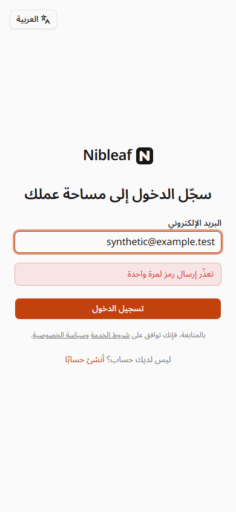
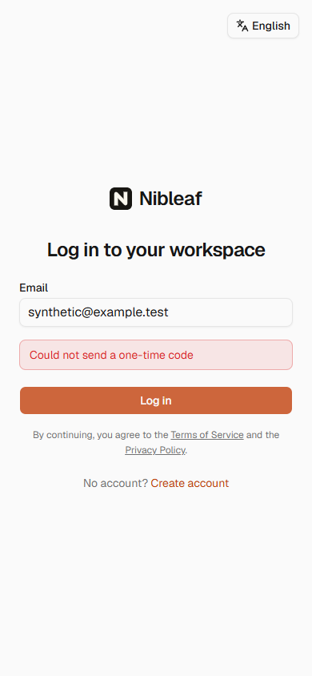

# Auth email failure feedback

These screenshots show the actual customer sign-in route in a local development preview at 390 × 844. The browser intercepted the OTP endpoint and supplied a synthetic HTTP 503 response containing `AUTH_EMAIL_UNAVAILABLE` and the English server message. Every API response in this browser was synthetic; no production account, customer data, credentials, provider requests, or email delivery are represented.

| Arabic RTL | English |
| --- | --- |
|  |  |

The Arabic browser check confirmed `lang=ar`, `dir=rtl`, HTTP 503, the localized alert text, the retained synthetic email, no OTP input, and no horizontal overflow. The English screenshot was captured after selecting English through the interface and retrying the same synthetic failure.

The preview resolved the unbuilt `@nibleaf/server/rpc` export to its tracked TypeScript source through an ignored local Vite config. No production bundle or image was built for these screenshots.

Equivalent interaction checks live in the route and account-settings React tests. Before the fix, five assertions failed because the English server message won over the interface translation. The tests also confirm that the installed `input-otp` 1.5.0 completes after the sixth digit has rendered and submits all six digits exactly once; its completion callbacks are unchanged.

These artifacts verify UI feedback, accessibility semantics, and draft retention. They do not prove production queue consumption or provider delivery; that remains tracked separately in issue #201.
