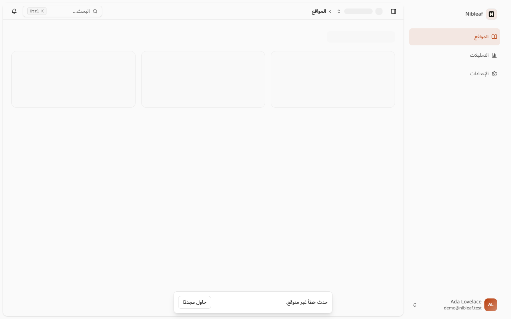
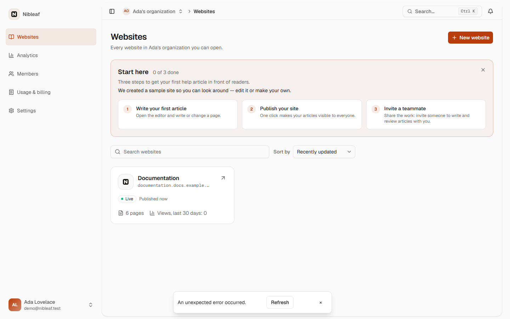
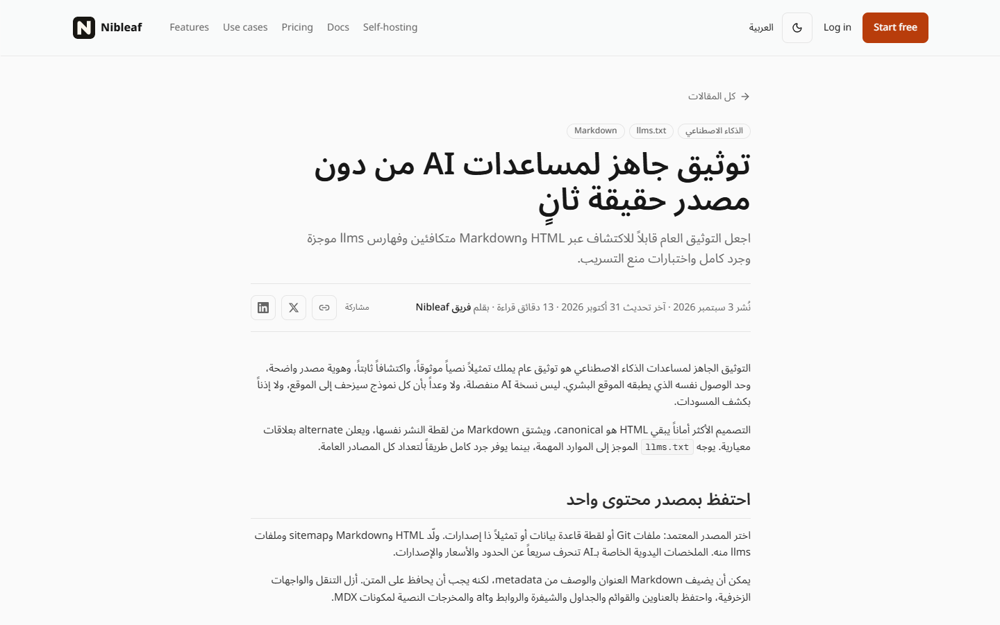
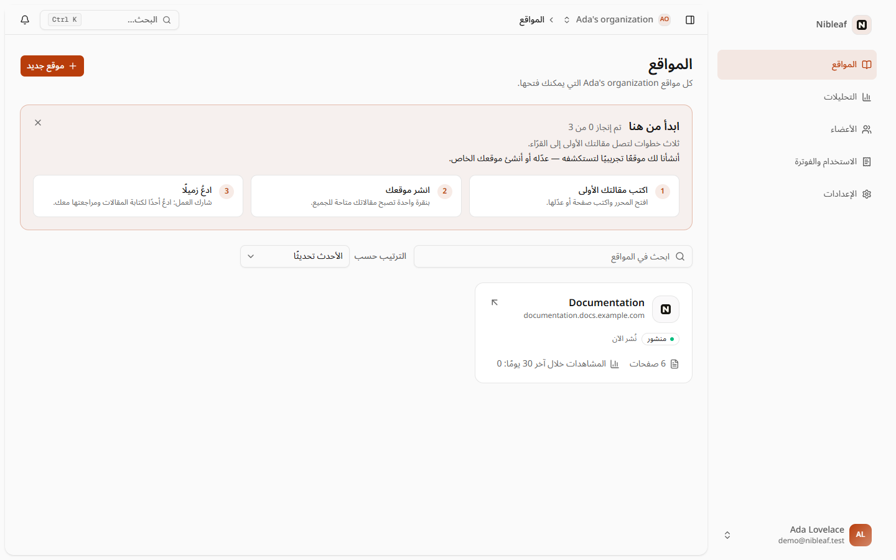
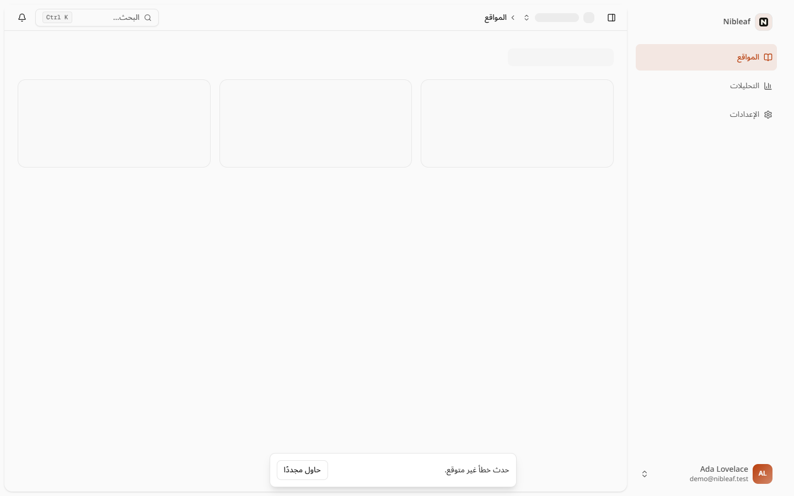
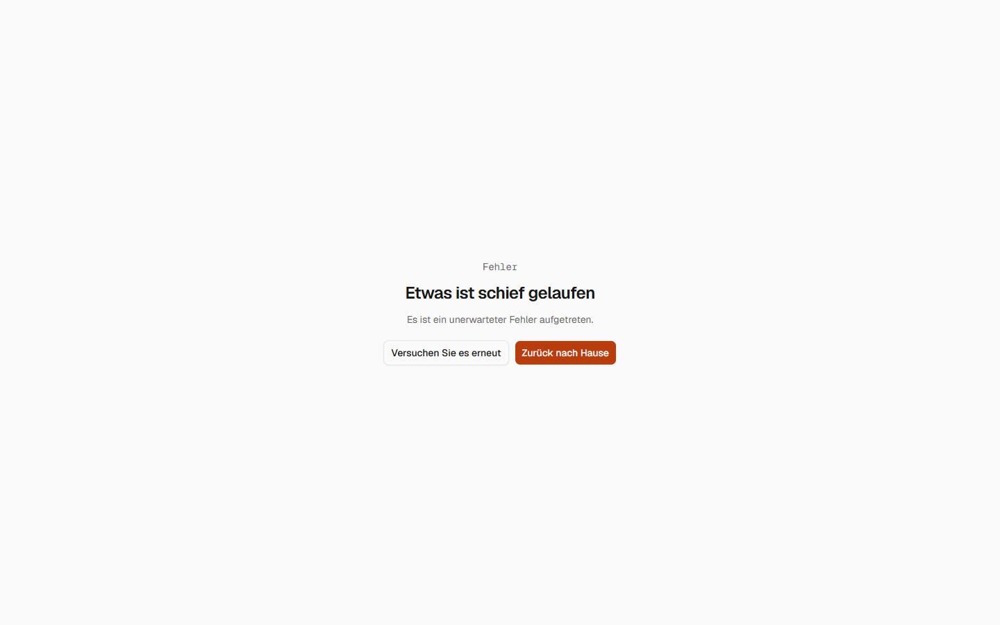

# Dashboard catalog evidence (#627)

Paired measurement base: `4a054cc420dfd5b96f84160d94f5e45c331e01c2` (2026-11-17).
The initial authorized base was `53b68848c7aa553d9d6d14c1113c34002ebe81f8`; current main was integrated before both builds. The historical issue measurements were not reused.

## Explicit-locale regression fix

Paired production builds against main `404c393b5f492835b402a2a9988dc8bb69e39414`, same dependencies and environment. Each unique JavaScript file is gzip-compressed at level 9. Routes that need a dashboard catalog include the locale bootstrap and the catalog closure; marketing and lazy pages include the page chunks a visitor downloads. Exact bytes are in [regression-sizes.json](regression-sizes.json).

| Route | main | PR, English | PR, Arabic | PR, largest locale (Russian) |
| --- | ---: | ---: | ---: | ---: |
| Dashboard home | 1,750,221 | 684,892 | 803,808 | 806,582 |
| Organization analytics | 1,845,782 | 780,455 | 899,371 | 902,145 |
| Private preview | 1,633,186 | 570,409 | 689,325 | 692,099 |
| Welcome name | 1,495,619 | 430,188 | 549,104 | 551,878 |
| OAuth consent | 1,593,723 | 528,575 | 647,491 | 650,265 |
| Join link | 1,618,113 | 552,868 | 671,784 | 674,558 |
| Accept invitation | 1,618,108 | 552,866 | 671,782 | 674,556 |

| Route without a dashboard catalog | main | PR |
| --- | ---: | ---: |
| Marketing home | 271,747 | 271,897 |
| Arabic comparison page | 1,609,380 | 378,574 |
| Blog article | 1,763,991 | 543,163 |
| Sign-in | 323,857 | 323,096 |
| Published docs page | 274,170 | 274,316 |

The fix keeps the saving. English dashboard startup is 2,173 bytes larger than the parked implementation measured below, for the routing and failure handling. Mixed-locale text now ships as named messages in the chunks that use it, all outside dashboard startup: slash titles about 7.7 KB gzip, page-language editor text 3.6 KB, Theme preview 5.2 KB (upper bounds, compressed separately).

**Lookup rule.** `translateFn` and `useLocale().t` read the active catalog only, and no application code passes them a locale. Text in a named language reads Paraglide's named messages through `@nibleaf/i18n/scoped`, which hold every locale synchronously: blog chrome, the Arabic comparison page, Theme preview, slash titles, inserted block text, placeholders, new-group names and export sizes. A parity test compares each of them with the full catalog in all twelve locales.

**Routes.** `/app`, `/git-preview`, `/welcome/name`, `/oauth/*`, `/accept-invite/*` and `/join/*` reach the translator, so each prepares its language before hydration and in its loader. The decision uses the route the router matched, so every URL form it accepts counts, including `/JOIN/token`, `/APP` and trailing slashes. A source test walks every route's imports and fails if another route can reach the translator. The bundle check rejects dashboard catalog code in any other route's preloads.

**When a catalog cannot load.**

| Moment | Behaviour |
| --- | --- |
| Hydrating a server-rendered page, including when the locale bootstrap itself cannot load | Keeps the server HTML unhydrated with a localized notice, and retries on a timer and when the connection returns. It never reloads by itself and never hydrates another language over the HTML. If the build looks replaced, or a retry fails online, the action becomes Refresh. |
| Navigating to a route | Never reloads by itself. The route shows its localized error page with Try again, or Refresh if the build looks replaced or a retry failed online. |
| Choosing a language | The current language stays usable, and a notice drawn without any lazy chunk offers Try again. If that fails online it offers Refresh, which saves the choice and loads the current build. A later language choice removes the notice, and the action re-checks that its request is still the latest. |

Try again always retries in place, and Refresh always reloads. A build looks replaced when the failed asset, or this page's entry script when the browser does not name the asset, answers 404 or 410. A false positive costs only an explicit reload. No failed catalog or bootstrap import triggers the automatic stale-chunk reload.

**Recovery re-check.** [Results](regression-recovery-results.json), on the same production setup with real emitted chunks blocked or answered 404 in the browser: mixed-case and trailing-slash hydration, a language switch on an upper-case dashboard URL, the network dropping during the catalog and the bootstrap requests, and a replaced build at hydration, on a first language choice and on navigation, plus a newer language choice replacing a failed one. **0 non-local requests.** Entries under `earlierResults` were not re-run because the latest change does not touch them.

| Connection lost during startup | Language chunk removed by a deployment |
| --- | --- |
|  |  |

**Browser check.** [Results](regression-browser-results.json), run on the production build with a disposable local database and services, app on 4310 and API on 4410: **0 non-local requests**. It covers Arabic blog and comparison hydration for English and Arabic browsers with no dashboard catalog request, Arabic `/join` hydration, a signed-in EN → AR → EN → failed DE → retry → EN switch [recording](regression-language-switch.webm) without a document reload, a cold Arabic dashboard, and all catalog failure paths above. The seeded account is fictional.

| Arabic blog, English browser | Dashboard after switching to Arabic |
| --- | --- |
|  |  |

| Catalog unavailable during hydration | Catalog unavailable on navigation |
| --- | --- |
|  |  |

Also captured: [Arabic blog at 390px](regression-ar-blog-390.png) and [the English dashboard before switching](regression-dashboard-en.png).

## Original implementation measurement

The tables, screenshots and receipts below were taken before the regression fix, on the base named above.

Both builds used this worktree's frozen-lockfile installation, Node 26.13.0, pnpm 10.34.9, identical app configuration and the existing route ancestry/preload method. Each unique JavaScript file is gzip-compressed independently at level 9. CSS, HTTP headers, cache reuse, server bytes and latency are outside this measurement.

| Profile | Before raw bytes | After raw bytes | Before gzip bytes | After gzip bytes |
| --- | ---: | ---: | ---: | ---: |
| dashboard-home | 6,059,766 | 2,243,684 | 1,749,786 | 682,501 |
| dashboard-analytics | 6,401,514 | 2,585,434 | 1,845,341 | 778,057 |
| auth-sign-in | 955,702 | 953,751 | 323,616 | 322,733 |
| auth-sign-up | 963,417 | 961,466 | 326,626 | 325,739 |
| public-docs | 787,515 | 786,366 | 273,746 | 273,328 |
| public-docs-index | 784,463 | 783,314 | 272,365 | 271,949 |

The unchanged route-preload denominator excludes the new pre-hydration bootstrap and, for non-English pages, the requested dynamic catalog. Counting their complete static dependency closures as well gives **682,719 bytes for English**, **801,635 for Arabic**, and **804,409 at the largest locale (Russian)**. English is the always-available base/fallback permitted by the issue design. The bootstrap adds 218 bytes beyond English's route preloads.

The baseline's largest dashboard asset was `react-Bd8TLmvw.js`: 4,355,439 raw / 1,166,162 gzip bytes. Its route closure included 4,989 legacy message modules. The new build contains twelve separate locale payload chunks, from 100,621 to 121,690 gzip bytes; English's chunk also contains the shared lookup/runtime. Chunk gzip is measured for the complete emitted chunk, rather than attributed to individual functions.

The new limits are 830,000 gzip bytes for dashboard-home **including bootstrap/active catalog**, and 125,000 per catalog chunk. The real checker was run against valid JavaScript fixtures with incompressible comments appended: oversized Arabic and dashboard-home fixtures both exited 1 for their intended budget. Their original SHA-256 bytes were restored, and the positive check passed again. Existing auth/docs thresholds and checks were preserved.

- [Before report](before-bundles.json), [after report](after-bundles.json): exact assets and bytes, all twelve startup totals.
- [Measurement receipt](measurement.json): full base, build environment, source fingerprint, generated-file hashes and catalog module attribution.
- [Negative checks](negative-budget-results.json): actual checker exit codes.

## Runtime and generation boundaries

The existing Paraglide 3.2.0 compiler generates the locale modules. A small generated alias map reuses its public index's canonical identifier aliases; message IDs, values, placeholders and plural grammar are unchanged. The stable dotted-key map remains shared. Synchronous render-time lookup uses the loaded locale, then English for an absent key.

`@nibleaf/i18n/dashboard-catalog` selects the client implementation only under the explicit `nibleaf-dashboard` condition, enabled in the app's Vite **client** environment. Default, ordinary browser/admin and SSR resolution keep the synchronous full namespace. Admin has no changes. Server locale resolution remains request-local; browser language changes do not mutate shared SSR state.

The app awaits locale preparation before dashboard route navigation and before hydration. Private preview received only the approved two-line loader preload; its query, Git workflow, schema, copy and error behavior are untouched. The shared path predicate covers every product route that reaches the translator, and excludes auth, marketing and published docs. Leaving the dashboard disables catalog loading for subsequent scoped-only language choices.

The bundle checker verifies one independent payload per locale, no nonactive payload in the initial/active static closure, no server catalog in dashboard preloads, and no dashboard catalog code in auth/docs preloads. The browser fixture additionally observed no nonactive catalog requests for EN/AR. This is source, manifest and local runtime evidence; it does not claim a production network trace for every language.

The Vite plugin regenerates during `buildStart` and when a source catalog JSON file is edited, added or deleted. Writes compare bytes first and publish with same-directory temporary-file rename. All writes stay within the ignored generated dashboard directory. **CONTRIBUTING's dev flow needs no extra step.** A direct app build starting with that directory deleted generated 38 files identical to `i18n setup`. A reversible Arabic dev edit changed only `messages/ar.js`, preserving all other hashes and mtimes; ten concurrent read samples saw complete old/new modules. Source and generated bytes were restored afterward.

## Verification

Focused i18n validation passed 22 tests across four files: differential message/placeholder/plural checks for all twelve locales, missing-key fallback, failed import and explicit retry, first-load fallback, rapid/out-of-order language choices, leaving-dashboard behavior, concurrent SSR isolation, and default/admin versus client export resolution. Both touched-package typechecks passed.

App focused validation covered 26 unique tests across five files, including the real PrivatePreview component's EN/AR hydration, navigation locale snapshots, existing interface-locale SSR/provider hydration and the new budget guards. One test initially lost its configuration-call receipt to shared test cleanup; its persistent predicate receipt was corrected and all three boot tests passed on rerun. Full touched-package suites and root pre-push gates are reported separately against the final commit in the PR.

[Browser results](browser-results.json) record all sixteen profiles, identical visible before/after text, no page errors, **0 non-local attempts**, the dev regeneration proof and actual built-app private-preview SSR/hydration in EN/AR (browser preference English, explicit locale cookie). The built app used an in-memory read-only mock API; every request was GET. No backing services, business data or provider writes were used. Owned processes stopped and ports 4310/4410 and the canonical devstack lock were released.

The [short recording](language-switch.webm) exercises an unavailable German chunk, unchanged English UI, explicit retry, and EN → AR → EN switching. A document marker survives every step, proving no reload. The fixture uses real sidebar/header/language-dialog components with fictional “Fixture Studio” data; it is a composed component comparison rather than a signed-in account journey. Private-preview SSR/hydration uses the actual production app build separately.

| Profile | 390px before / after | 1440px before / after |
| --- | --- | --- |
| EN light | [before](before-en-390-light.png) / [after](after-en-390-light.png) | [before](before-en-1440-light.png) / [after](after-en-1440-light.png) |
| EN dark | [before](before-en-390-dark.png) / [after](after-en-390-dark.png) | [before](before-en-1440-dark.png) / [after](after-en-1440-dark.png) |
| AR light | [before](before-ar-390-light.png) / [after](after-ar-390-light.png) | [before](before-ar-1440-light.png) / [after](after-ar-1440-light.png) |
| AR dark | [before](before-ar-390-dark.png) / [after](after-ar-390-dark.png) | [before](before-ar-1440-dark.png) / [after](after-ar-1440-dark.png) |

## Reproduction commands

Use the owner's heavy/devstack resource protocol. Install and generate in your own checkout; do not borrow dependencies or build output.

```sh
pnpm install --frozen-lockfile
pnpm --filter @nibleaf/i18n run setup
# Both measurements use these identical environment values:
export NODE_OPTIONS=--max-old-space-size=6144 BUNDLE_ANALYZE=true
export VITE_API_URL=http://127.0.0.1:4410 MARKETING_GITHUB_STARS=0
pnpm exec turbo run build -F '@nibleaf/app^...' --concurrency=1 --force
pnpm --filter @nibleaf/app build
node apps/app/scripts/check-bundle-budget.mjs --json /your/evidence/bundles.json
# On the implementation, also run --check. Baseline predates these new budgets.
node apps/app/scripts/check-bundle-budget.mjs --check
pnpm --filter @nibleaf/i18n exec vitest run src/dashboard-catalog.test.ts src/dashboard-catalog.client.test.ts src/dashboard-catalog.ssr.test.ts src/dashboard-catalog-resolution.test.ts --no-file-parallelism --maxWorkers=1
pnpm --filter @nibleaf/app exec vitest run src/lib/dashboard-locale.test.ts src/routes/-dashboard-catalog.hydration.test.tsx scripts/dashboard-catalog-budget.test.mjs src/routes/-interface-locale.ssr.test.tsx src/components/localized-product-providers.hydration.test.tsx --no-file-parallelism --maxWorkers=1
# Under heavy lock, with BASELINE=<full base> and NIBLEAF_HEAVY_OWNER=<exact owner>:
node .github/assets/dashboard-active-locale/capture.mjs build
# After releasing heavy; NIBLEAF_DEVSTACK_LOCK names the canonical directory:
# CHROME_PATH may select the local Chrome executable without hardcoded paths.
node .github/assets/dashboard-active-locale/capture.mjs capture
```

Final ai-slop-cleanup review covered the owned runtime, generator, export condition, narrowly granted route hunks, budget checks, tests and evidence harness. No actionable slop remained after the alias/parity and test-receipt repairs. The optional-load adapter and default server boundary serve the measured failure/compatibility contracts; no translation grammar, framework or dependency was added.
