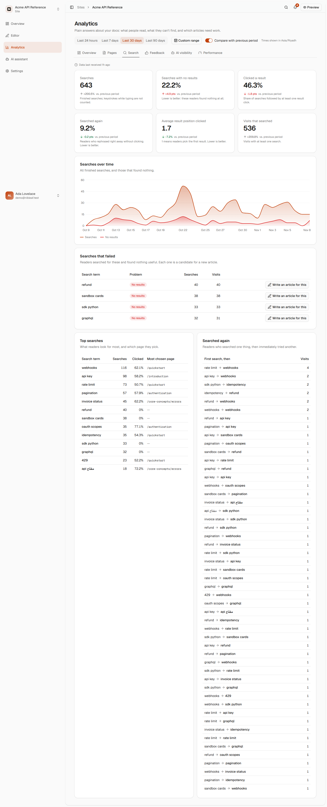
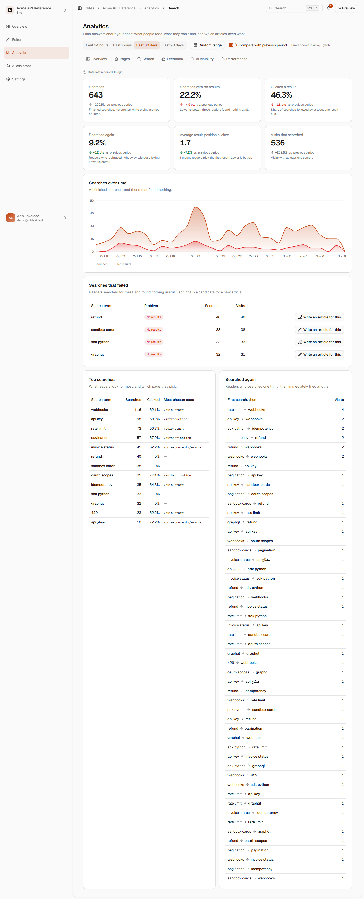
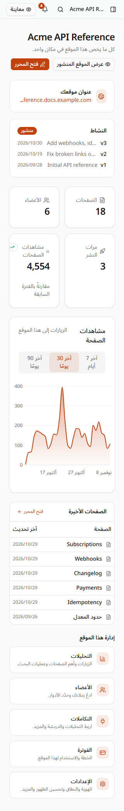
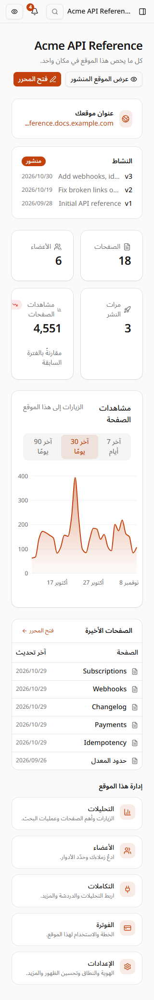
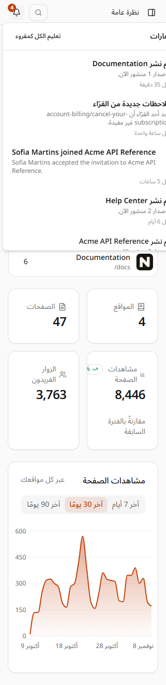
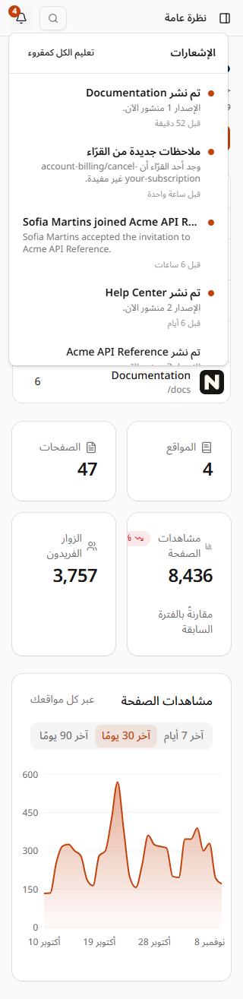
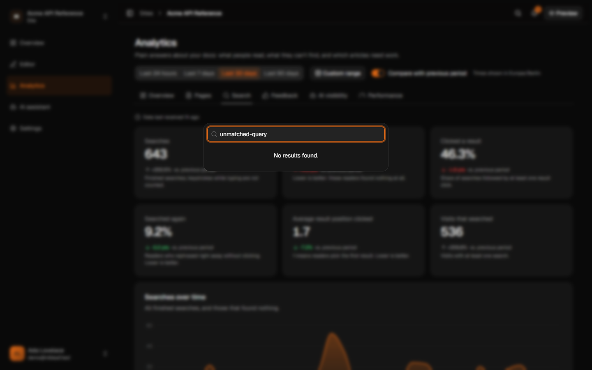
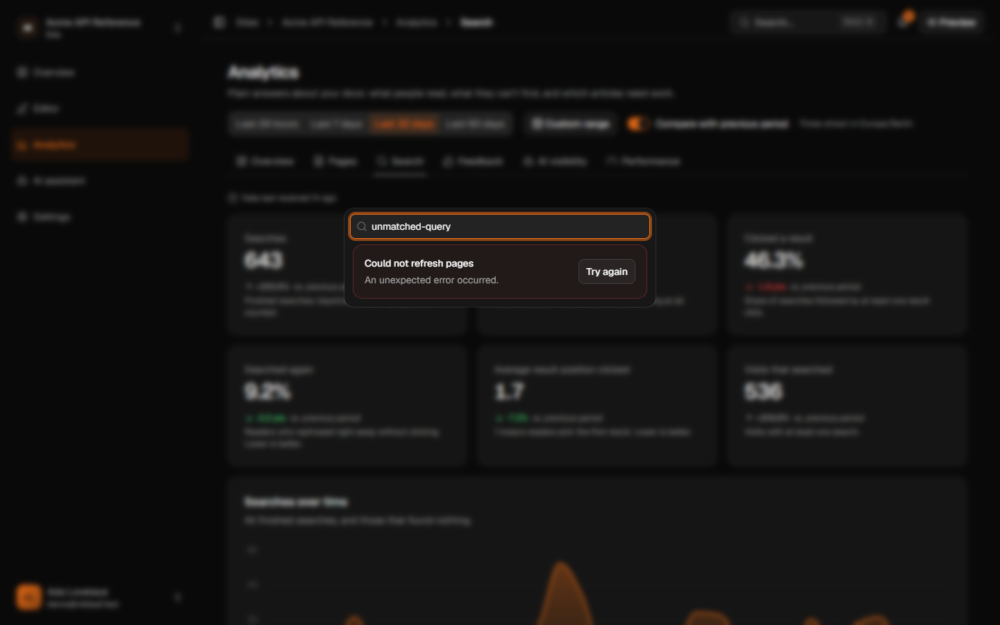
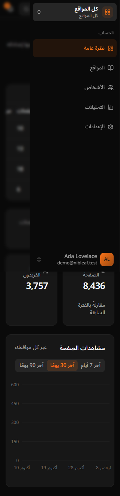

# Dashboard shell navigation evidence

Baseline: `origin/main@72699708` (#375). After: the shell-navigation implementation in this PR.
Captured 2026-11-08 with the supplied council seed and headless installed Chrome. The same isolated database was retained throughout. Relative times and rolling-window totals reflect each capture time.

The branch was subsequently rebased onto `d98b26bb`. All 11 shell runtime files and the 84 added translations are byte-for-byte/value-identical across that rebase; the receipt records their blob identities. Required static checks were rerun after the rebase. The browser evidence remains qualified to the recorded capture base. The final storage-only rebase to `4f70e252` preserves the entire app/design-system/i18n trees, lockfile, root scripts and Turbo config; their test/build receipts were retained, with dependency typecheck, lint and dead-code checks repeated.

The harness covered workspace/project headers, analytics Search/Pages, AI, the open mobile sidebar, notifications, and the palette in EN desktop light/dark and AR 320px light/dark: 32 before and 32 after captures. The final captures have zero console errors and zero document horizontal overflow. One after-capture navigation hit the 45-second network-idle timeout; its targeted retry passed. Both attempts are retained in [verification.jsonl](verification.jsonl).

Document overflow was also zero before the fix, despite clipped portaled popups. Direct popup bounds reproduced the defect: notifications were 360px wide and the 320px date popup extended 5px past the viewport. Both now measure 288px wide and fit inside 320px.

| State | Before | After |
| --- | --- | --- |
| Analytics breadcrumb, EN light |  |  |
| Project header, AR 320px |  |  |
| Notification popup, AR 320px |  |  |
| Failed page read, EN dark |  |  |
| Open sidebar, AR 320px dark |  |  |

[15.48-second Arabic mobile interaction recording](mobile-shell-ar.webm)

## Latest published-docs comparison

Main's analytics update (#387) was merged without rebasing. Fresh gzip level-9 measurements against base `28ac9523`:

| Profile | Main | This PR | Change |
| --- | ---: | ---: | ---: |
| public-docs | 345,919 bytes | 345,726 bytes | -193 bytes |
| public-docs-index | 345,097 bytes | 344,905 bytes | -192 bytes |

Latest-base checks passed: 8 Turbo typecheck tasks, lint, dead-code, 269 app files (2,927 tests passed, 14 existing opt-in skips; two workers), 145 i18n tests, analyzed production build and bundle boundaries. The earlier focused shell/palette run passed 32 tests. An initial latest-base full run hit the inherited five-second marketing canonical-URL timeout; its isolated file passed 142 tests, then the unchanged full suite passed with two workers. Cleanup review found no additional actionable issues.

The 645 eager module IDs match main. The sole rendered-byte change is `lib/shortcut.ts`, reduced from 1,068 to 946 bytes. Both profiles meet the no-growth rule with no exception or budget increase. The earlier measurements below remain qualified to their recorded main revisions.

## Initial published-docs bundle follow-up

Exact gzip level-9 route-preload totals, measured in the same worktree against base main `52de4bc2`:

| Profile | Main | Before fix (`05997a9a`) | After fix | Change from main |
| --- | ---: | ---: | ---: | ---: |
| public-docs | 346,320 bytes | 346,427 bytes | 346,060 bytes | -260 bytes |
| public-docs-index | 345,497 bytes | 345,604 bytes | 345,238 bytes | -259 bytes |

The security update (#389) was merged, and fresh main/branch builds produced identical eager assets and module reports to the earlier comparison against `a9cfb175`.

The original 107-byte increase in each profile came from generated Vite preload metadata and changed content hashes. Every eager module ID and rendered byte count was identical to main; Popover, Sidebar, Breadcrumb and MESSAGE_IDS were absent from both eager-module reports. The entry's 14 raw added bytes were generated dependency metadata, not message-ID entries.

The shared header search button now lives in its own app component, with the palette-opening hook restored. This keeps its icon and shortcut imports out of the app-wide palette's dependency graph. The resulting reader shortcut module is 122 rendered bytes smaller than main, and neither published-docs profile grows. No message-ID exception or budget increase is used. Popover bounds, localized sidebar names and header behavior are preserved. A component regression verifies that the separate header button still opens the app-wide palette.

The council measurement helper was copied locally and excluded from Git. Browser captures remain the historical evidence above; this module-boundary change has no visible UI change.

## Council review follow-up

The bell now uses the plain localized name when the unread count is zero, including after marking all notifications read. Positive counts retain the formatted unread name and badge. The notification component suite verifies counts 0, 1, 12, and 1,234 and the transition to zero; all 12 tests passed. The browser script's zero-state expectation was updated to the plain localized label, but that script and the gallery were not rerun for this accessible-name-only correction. Their receipts below remain historical evidence from the initial delivery.

The follow-up was rebased onto `origin/main@551fdcff`. Its fresh check results are recorded below and in `verification.jsonl`. Cleanup review of the follow-up's three code/test hunks found no additional actionable issues; optional spacing and workspace-group-label nits were left unchanged.

- App/design-system Turbo typecheck: 8 tasks passed. Lint and dead-code checks passed.
- Full app suite: `pnpm --filter @nibleaf/app test --maxWorkers=2`, 262 files passed, 2,891 tests passed and 14 existing opt-in tests skipped. An initial four-worker run hit the inherited site-search lazy-import `beforeAll` timeout; the focused file passed all 48 tests, then the full two-worker run passed with deadlines, assertions and selection unchanged.
- i18n parity and tests: 4 files, 145 tests passed. Design system has no test script; its typecheck and app coverage passed.
- Analyzed production build and bundle checks passed: public docs 337.96 KiB gzip, index 337.16 KiB, budget 340.04 KiB (348,200 bytes). Module and copy boundaries passed.
- Updated browser script syntax check passed. No browser/runtime or screenshot rerun is claimed for this follow-up; the accessible-name correction is verified by the component tests above.

## Initial delivery verification

- App/design-system Turbo typecheck: 8 tasks passed.
- App suite: `pnpm --filter @nibleaf/app test --maxWorkers=4` passed all 253 files: 2,807 tests passed, 14 existing opt-in tests skipped. Default-worker runs hit cold-import timeouts in the inherited marketing and site-search tests; the focused marketing file passed 142 tests, and the four-worker full run preserved all deadlines, assertions, and test selection.
- i18n: 4 files, 132 tests passed, including catalog/key/variable parity and shell translations.
- Lint and dead-code checks passed.
- Design system has no test script; its typecheck and the app's real primitive/component/browser tests cover the changes.
- Analyzed production build and bundle checks passed. Public docs: 338.15 KiB gzip; index: 337.34 KiB; ceiling: 340.04 KiB (348,200 bytes). Module and copy boundary checks passed.
- The [headless browser regression](check-browser.test.mjs) passed with 21 recorded checks across EN/AR/DE: localized dialogs/landmarks, one current breadcrumb, site/Workspace/New site sheet dismissal, popup bounds/scroll reachability, query retry, and notification unread state plus persisted mark-read.
- Popup checks used 320×720, 320×300, and 720×450 CSS viewports. The last represents a 1440×900 window at 200% zoom; native browser zoom controls were not driven.
- Notifications stayed at four unread throughout the gallery captures. The final browser test then marked all read, verified row/bell changes, and read back zero from the API.

Run the browser test after screenshots against a fresh local council seed with four unread notifications. It requires the seeded `demo@nibleaf.test` session, rejects non-local hosts, and marks that fixture inbox read. It injects only the failing reads used to verify recovery.

```powershell
$env:BASE = 'http://localhost:4510'
$env:COOKIE_FILE = 'C:\path\to\cookies.txt' # name=value lines, as used by shots.mjs
node --test .github/assets/dashboard-shell/check-browser.test.mjs
```

The owner-approved isolated `nibleaf-dashui-gpt` infrastructure used +220 ports because +120 belonged to `nibleaf-import`. App/API/worker used 4510/4511/4512. Owned dev processes and the compose project were stopped; volumes and the fixture recovery snapshot were retained. The import stack was untouched.

Cleanup review covered the task diff against `72699708`. Recovery controls now sit outside the command listbox, and breadcrumb ancestors use exact route matching. Existing primitives/query hooks were reused; no remaining actionable cleanup findings were identified.

L1 (repeated New site deep-link intent on the already-mounted sites/index routes) remains a follow-up in the excluded files.
