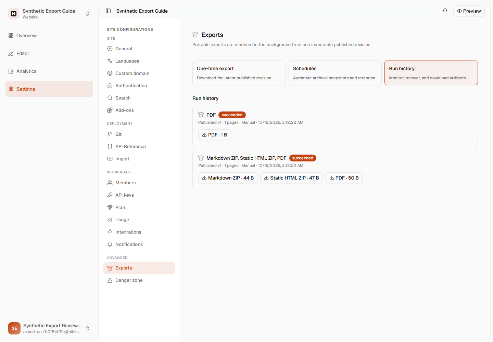
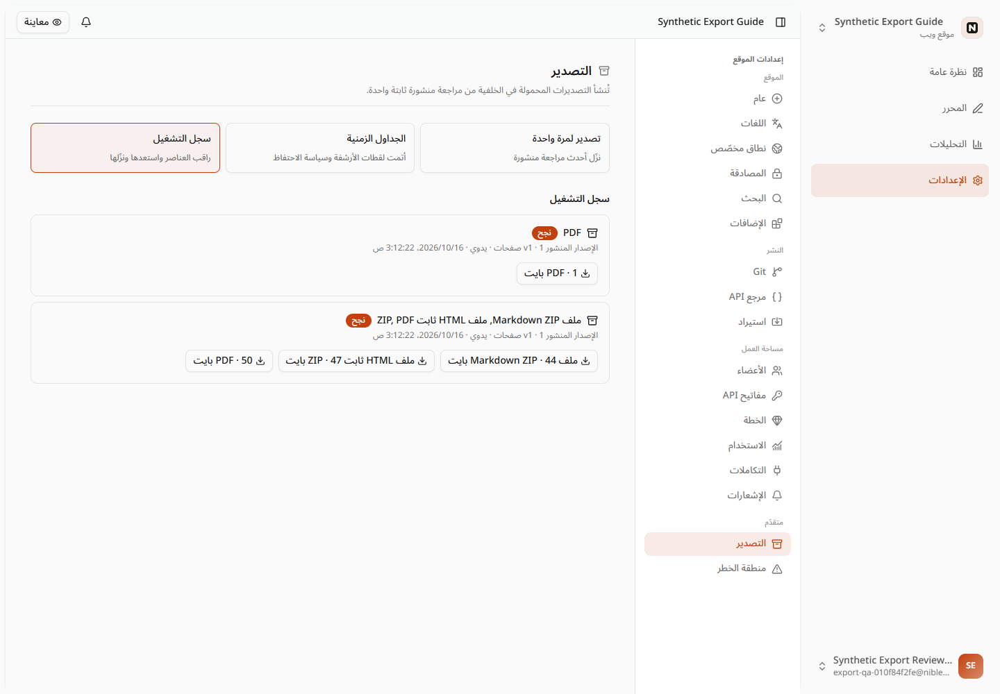

# Export download regression evidence

The dashboard now downloads retained exports through its authenticated, same-origin API proxy. The API sets an attachment disposition, including a safe ASCII filename and RFC 5987 Unicode filename, and streams storage bytes without assembling a browser Blob or buffering the entire artifact. The existing JSON signed-URL fields remain available to API clients; `fileUrl` is additive. Ordinary asset signing is unchanged.

## Source regressions

The [sanitized test results](regression-results.json) record three baseline UI failures at `42ac499`: the selected artifact does not produce a native download link, and a 1,024-byte archive displays zero megabytes in both English and Arabic. The candidate passes 38 focused tests: 17 dashboard/size tests and 21 server tests.

The real Hono endpoint tests exercise the existing authentication and project-membership middleware with a mocked membership resolver, database and storage. They verify:

- Authentication, target-project membership, artifact ownership/success and retention expiry before storage access.
- PDF and ZIP attachment headers, Unicode filename encoding, and control/path rejection before streaming.
- Private/no-store, nosniff and sandbox headers, exact fixture bytes, and unchanged signed-URL API fields.
- A chunk reaches the response before the source finishes, client/request cancellation destroys the source, and storage failures do not become a successful HTML download.
- Selecting the PDF artifact produces a same-origin native download link with its returned filename, without opening a new tab; a failed preflight reports its error and produces no link.
- Byte/KiB/MiB/GiB thresholds in English and Arabic, including zero, single bytes, fractions, and both sides of unit boundaries. Numbers follow the existing Western-digit convention.

The new `export_file_requested` audit event records a request, not transfer completion. The existing signed-link event retains its prior behavior.

## Default storage compatibility

An independent, isolated probe of the cached **MaxIO 0.4.2** image returned the same 60-byte fictional fixture for baseline, English/Arabic signed attachment overrides, and persisted attachment metadata. Every response omitted `Content-Disposition`. The [sanitized compatibility receipt](maxio-compatibility.json) preserves status/type/checksum evidence without credentials, object keys, signed URLs, container identifiers or local paths. This agrees with the [tagged provider source](https://github.com/coollabsio/maxio/blob/v0.4.2/src/api/object.rs#L741-L924).

That result is why the UI uses the authenticated streaming endpoint rather than relying on storage-specific response overrides. It does not establish the cause of the original production Chrome automation cancellation, whose storage response was not captured.

## Compiled browser and API acceptance

An independent check built the candidate app and API, then exercised the actual Nitro proxy, BetterAuth session, PostgreSQL membership/retention checks and MaxIO storage against new fictional fixtures in disposable QA services. The [sanitized compiled receipt](compiled-acceptance.json) records the compiled source hashes; this is local source-build evidence, not an immutable image or production receipt. Local checks used Node 24.21.0; required CI verifies the supported Node 22 runtime.

- Each of the three formats returned the expected attachment content type/disposition, private/no-store and nosniff headers. All three response byte counts and SHA-256 hashes matched their stored fixture metadata. Nitro transferred these responses without a Content-Length header; byte identity was checked directly.
- Anonymous requests returned 401, and foreign-workspace and expired artifacts returned 404, with no attachment header or artifact bytes.
- All three native browser downloads passed in both English and Arabic: all six saved files were rehashed against the stored sizes/checksums, with exact suggested filenames including Arabic/em-dash characters, unchanged workspace URLs and zero page errors. Expired preflights produced no download and kept the workspace in both languages.
- A controlled successful preflight pointing at the expired fixture also retained the workspace and produced no successful artifact; the native download reported `canceled`. Chrome exposed no page-level request/response events for that failed download, so its browser HTTP status is unknown. The direct authenticated HTTP check separately established the expired endpoint returns 404.
- The 44/47/50-byte objects are opaque fictional transport markers. These checks establish download behavior and byte identity; they do not claim valid ZIP/PDF generation or PDF rendering.

The screenshots show nonzero localized byte labels and retained history UI:

| English | Arabic / RTL |
| --- | --- |
|  |  |

[Short Arabic download interaction recording](ar-downloads.webm)

## Reproduce focused checks

```sh
pnpm install --frozen-lockfile
pnpm --filter @nibleaf/i18n run setup
pnpm exec turbo run build --filter=@nibleaf/server...
pnpm --filter @nibleaf/app exec vitest run src/components/project-settings/exports-section.test.tsx src/lib/export-file-size.test.ts
pnpm --filter @nibleaf/server exec vitest run src/modules/app/exports/download.test.ts src/actions/exports.test.ts
pnpm --filter @nibleaf/storage --filter @nibleaf/server --filter @nibleaf/app run typecheck
pnpm run check:dead-code
```

These are synthetic local source/provider checks. Production file-transfer acceptance remains a release check after deployment. No Docker build, production mutation, customer content, auth credentials or external-provider request is included in this evidence.
