# Editor save reliability verification

Baseline: `origin/main` at `2a80024f2752e5bdfdcde64e3e110bc75fccc629` (2026-11-11).

## Failing-first regressions

Run the two new test files against the baseline implementations:

```text
vitest run src/hooks/api/mutations.editor-save.test.tsx src/routes/app/projects/$projectId/-editor-save.test.tsx
AUTH-15 measured queryFn refetches { lists: 2, detail: 2, changes: 1 } PATCH 1
FAIL AUTH-15: expected list refetch count 0, received 2
FAIL AUTH-07: expected toast editor.createFailed; number of calls: 0
FAIL AUTH-16: offline autosave remained paused/pending; timed out after 5000ms
FAIL AUTH-16: offline banner showed editor.saveError instead of site.aiOffline
FAIL AUTH-16: undo cancelled the debounce but editor.savingShort stayed visible
Test Files 2 failed (2); Tests 5 failed | 4 passed (9)
```

The existing ordinary error, revision-conflict and unmount paths already passed on main. These remain regression coverage; they are not claimed as new baseline failures. Creation is server-confirmed, without optimistic phantom rows. The tests also check pending-state cleanup and focus restoration.

After implementation: both files pass, 9 tests. The real mutation hook runs with the shared QueryClient/MutationCache. Lifecycle tests mount the real editor route and real debouncer, mocking API hooks and unrelated editor panels. The unmount test resolves a held save after unmount, remounts, and checks status and console errors. The offline hook test also sets TanStack's online manager offline, so it detects paused mutations independently of navigator.onLine.

## Measured requests per successful content autosave

| Measurement | Main | Patched |
| --- | --- | --- |
| Query-observer harness (two active list variants) | 2 list GETs + 2 detail GETs + 1 pending-changes GET; 1 PATCH | 0 list GETs + 0 detail GETs + 1 pending-changes GET; 1 PATCH |
| Chromium real app/API (one active tree list), each EN/AR desktop/phone run | 1 list GET + 2 detail GETs + 1 pending-changes GET; 1 PATCH | 0 list GETs + 0 detail GETs + 1 pending-changes GET; 1 PATCH |

The pending-changes refresh is intentionally retained for publish readiness. This is **zero page refetches**, not zero total GETs. Structural edits (including title edits that change an unpublished address), creates, deletes and moves retain invalidation. The response already includes the full Page and revision stamp; no server response change was needed.

Sanitized browser request captures: [before](before-requests.json), [after](after-requests.json). Counts start after initial editor hydration and exclude the injected failure used for media.

## Media

Headless playwright-core Chromium 1248, real editor/API, fictional QA account in the isolated `nibleaf_editor_save_20261111` namespace. App/API ports 4880/4881. No worker was started, so the unrelated starter publication remains pending in the header. The page content is the English starter; Arabic captures exercise the Arabic UI and RTL layout.

Each recording shows a successful content save, followed by a browser-transport PATCH failure with navigator.onLine=false. The before version shows a generic error; the after version shows localized offline feedback and the existing retry action. Screenshots are the resulting error state. GIFs are screen captures at 400ms intervals; each is under 0.3 MB.

| Locale / width | Before screenshot | After screenshot | Before GIF | After GIF |
| --- | --- | --- | --- | --- |
| English 1440 | 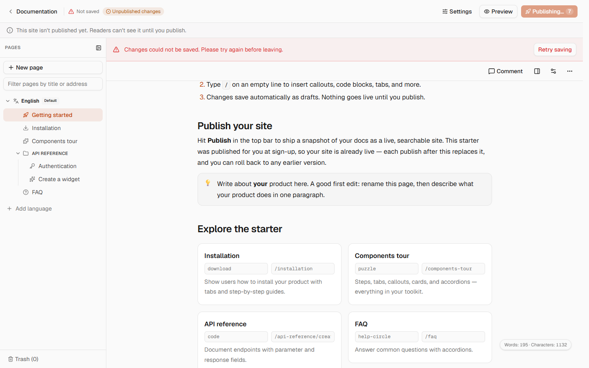 | 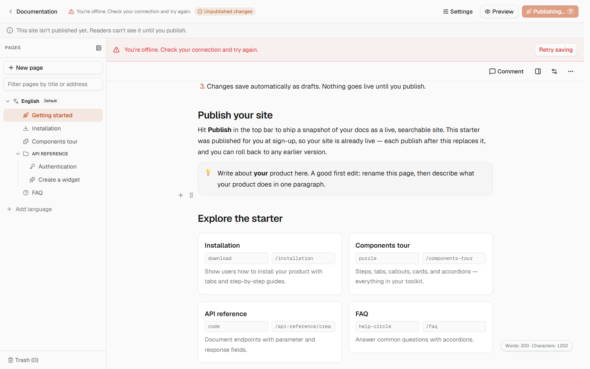 | 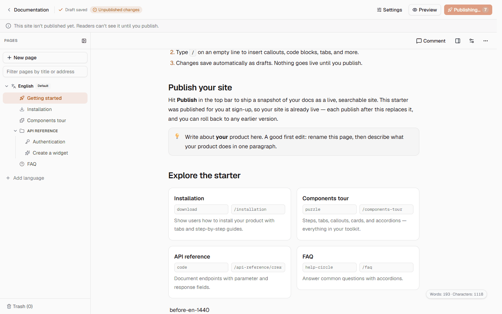 | 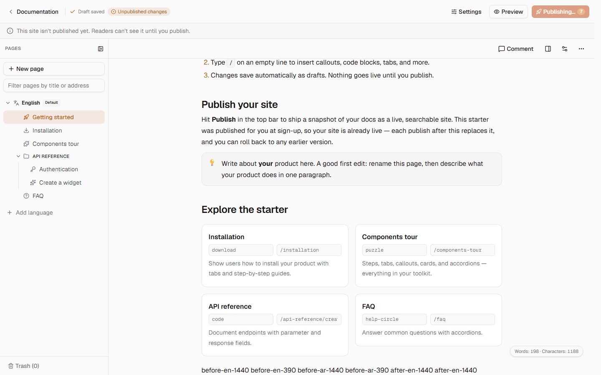 |
| English 390 | 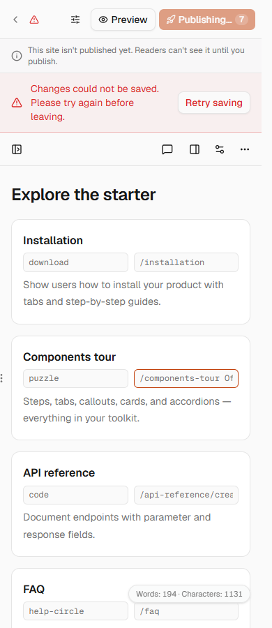 | 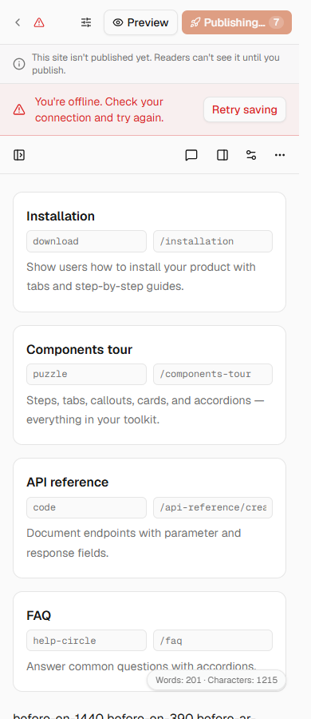 | 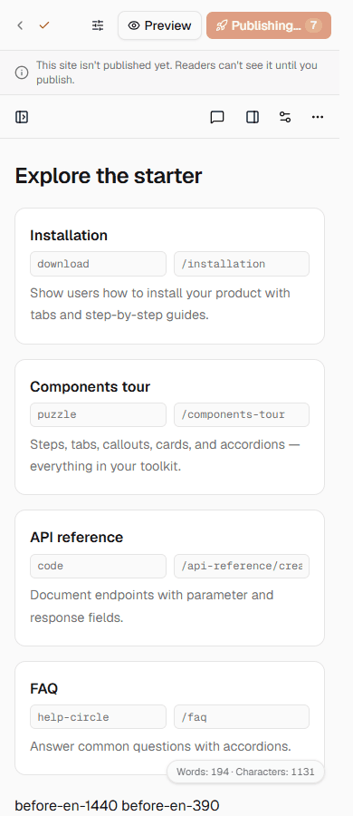 | 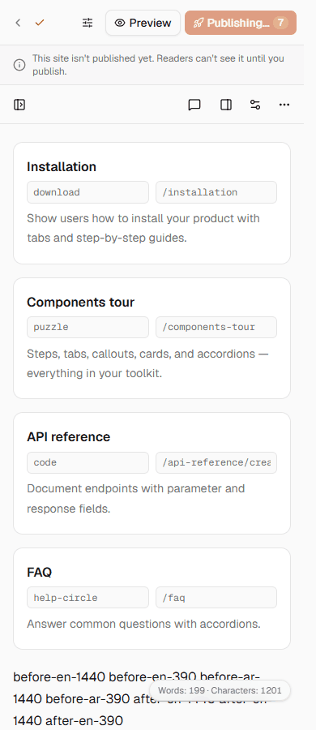 |
| Arabic 1440 | 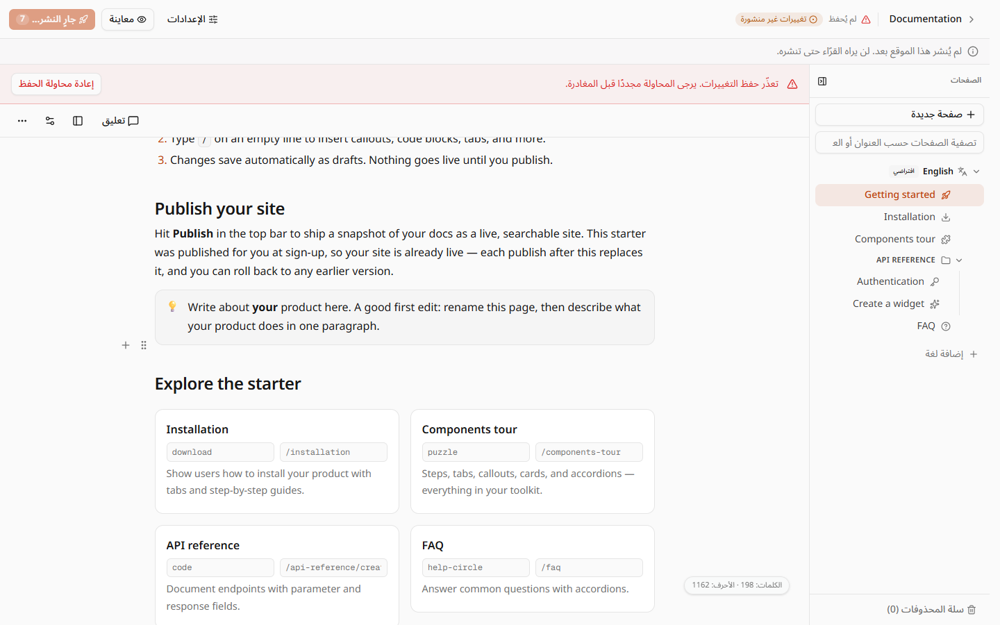 | 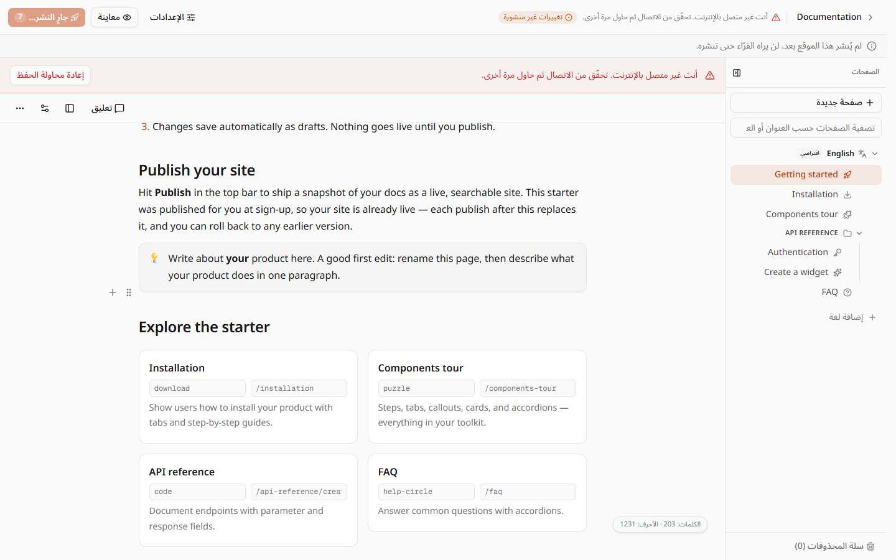 | 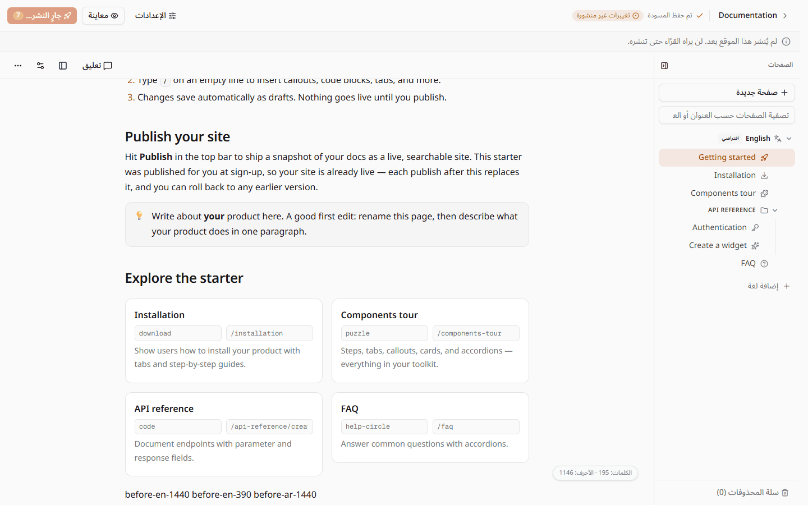 | 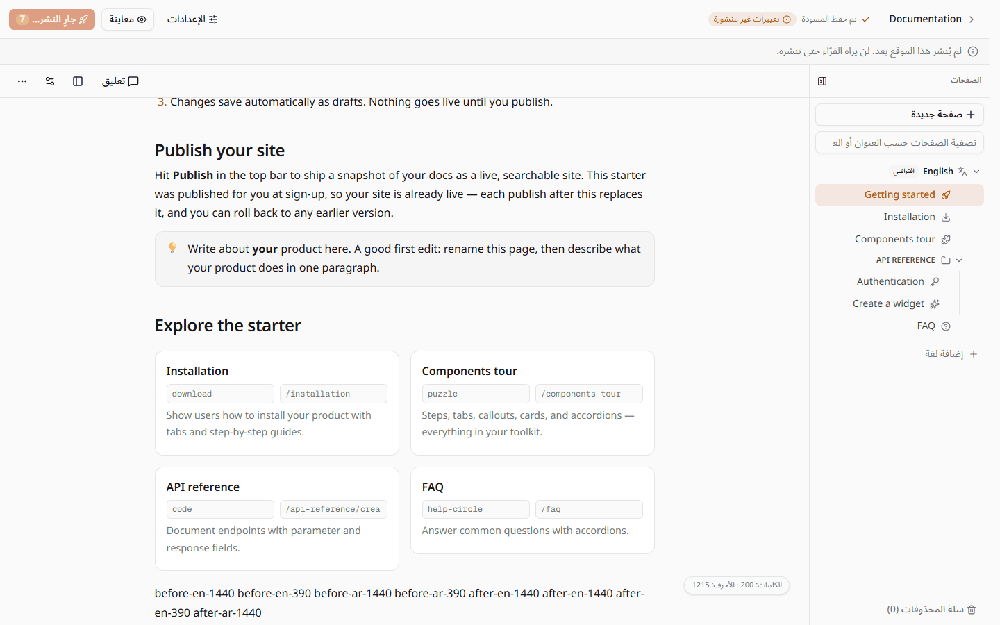 |
| Arabic 390 | 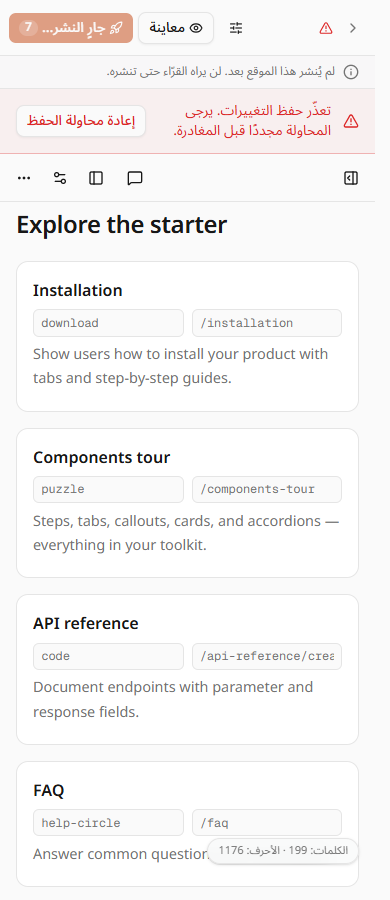 | 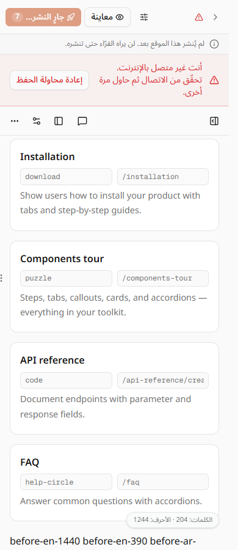 | 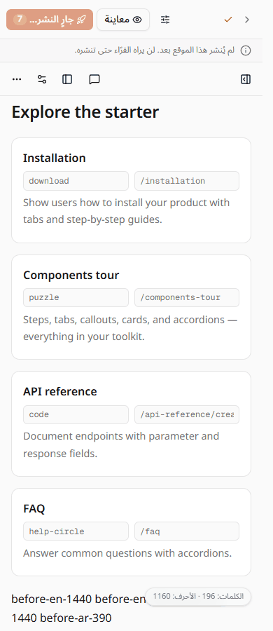 | 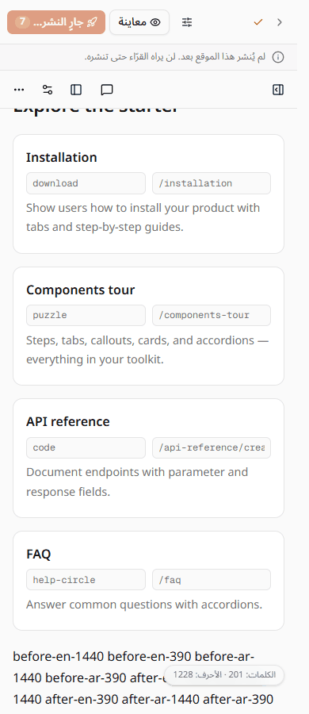 |

The shared stack lock was acquired atomically and released after stopping owned PIDs and confirming neither port had a listener. No containers were started or removed; shared services were preserved.

## Bundle comparison

Production builds with BUNDLE_ANALYZE=true and gzip level 9 reporting:

| Profile | Main | Patched | Delta |
| --- | --- | --- | --- |
| public-docs | 270.96 KiB | 270.96 KiB | +0.00 KiB |
| dashboard-home | 1281.65 KiB | 1282.63 KiB | +0.98 KiB |

Rounded reporter values; public-docs remains under its 337.01 KiB budget. All UI copy reuses existing keys. The offline key already existed in all catalogs; its ten English placeholders are now translated, including formal German. No new message IDs or server i18n imports were added.

## Local validation

- Full `pnpm exec turbo run typecheck`: 27 tasks passed.
- Full app suite: 372 files passed, 4,522 tests passed, 14 skipped.
- Full i18n suite: 4 files and 146 tests passed.
- Root `node --test scripts/*.test.mjs`: 175 passed, 28 skipped, zero failures.
- `pnpm knip`: passed, with three existing configuration hints.
- `pnpm exec biome check .`: passed, with 50 existing warnings outside this change.
- `BUNDLE_ANALYZE=true pnpm build:app` and app `bundle:check`: passed.
- `git diff --check`: passed.

Cleanup reviewed the owned diff and creation callers: duplicate save-error state handling was removed; shared error reporting preserves analytics' existing language-refresh retry and final toast. No additional abstractions or optimistic cache writes were introduced. Runtime media covers the real local app/API, not production deployment acceptance.
