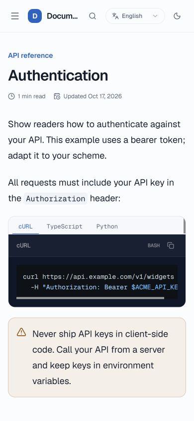
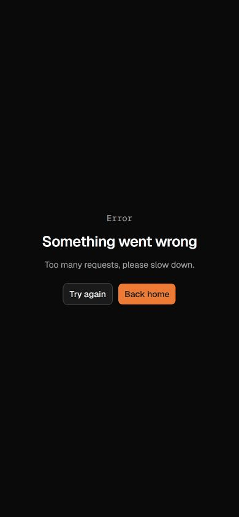

# Reader retry verification

Captured in Chrome on 2026-10-17 using the production app build and source API, a fictional documentation project, and a verified 390 × 844 mobile viewport.

The isolated local API uses a four-request, 60-second public bucket to reproduce the failure. Production retains its existing 300-request limit and visitor attribution. No provider calls or customer records are involved in this fixture.

- Before: API returned 429 with `Retry-After: 60`; the rendered page returned 500 without that header. Resetting the boundary after the window elapsed still showed the error.
- After: the same rendered error returns 429 with `Retry-After: 60` and `Cache-Control: private, no-store`.
- Once the window expires, clicking **Try again** reloads the failed route and opens the Authentication article. `retry-recovery.gif` is a continuous 14-second browser recording of that successful interaction; the PNGs show the error and recovered states.

This controlled local verification does not establish production load capacity.

