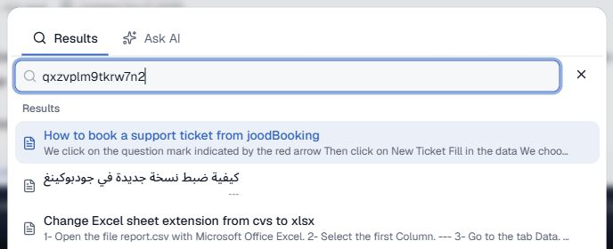
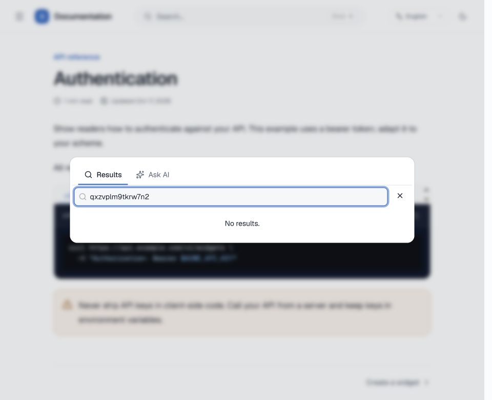
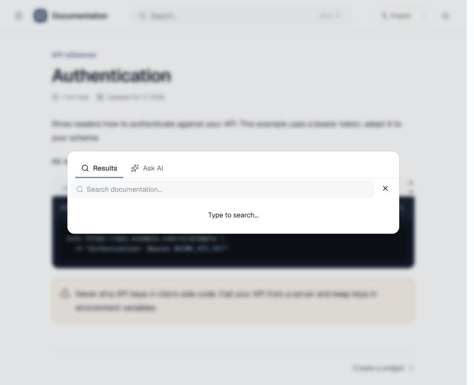

# Unmatched-query verification

Captured in Chrome on 2026-10-17 with the local QA documentation project at an actual 960 × 780 viewport. The baseline screenshot is cropped to the query and first three unrelated results; the corrected view and recording retain the full viewport.

- Before: the immutable `fad2815` API returns 12 unrelated results for `qxzvplm9tkrw7n2`.
- After: the source API applies a dense cosine minimum before rank fusion, returns zero hits, and the existing reader displays **No results.** Both views use the same reader UI and published fixture.
- `empty-result.gif` is a continuous 12.3-second capture of entering that query and receiving the corrected empty state.

The real Qdrant integration test separately proves that a weak vector-only neighbor is excluded and an exact lexical match with a weak vector survives. Existing tenant and page-grant filters remain in both lanes.

A paired, read-only check against the customer corpus covered 21 queries: ten declared target pages, four additional semantic queries, five unmatched queries, and two separately observed off-topic queries. All five unmatched cases changed from ten results to zero; all 14 valid queries retained results; all ten target pages remained in the top ten. This is bounded calibration, not a universal relevance guarantee. Off-topic queries with overlapping lexical terms can still produce related candidates.

`SEARCH_DENSE_MIN_SCORE` defaults to `0.35`. Operators changing embedding models should calibrate it; `-1` preserves unrestricted dense retrieval. The threshold applies before RRF because rank-fusion scores alone cannot establish semantic relevance. No schema change or reindex is required.

