# AI and integrations, from the site owner's side

Status: **proposal, for the master's review.** No code changes yet.
Scope: Site settings → Integrations, Smart AI, and the AI part of Search. Assets live in
[`ai-and-integrations/`](ai-and-integrations/): screenshots in `shots/`, low-fi mockups as `mockup-*.png`, and their
source in `mockups.html`.

The owner's verdict on today's screens: *"it sucks tbh, illogical and bad UI/UX experience… you are not seeing stuff
from user perspective."* This document walks the six jobs a site owner comes to these screens for and records where
each one breaks. It then proposes an information architecture built around those jobs rather than around our provider
catalog.

## 0. Summary

- **Integrations is a dump of our server's parts, not the site owner's tools.** 20 cards, 10 of them infrastructure the
  owner can't touch (Qdrant, ClickHouse, Postmark, SMTP, Maxio, MinIO, S3, R2, B2, Cloudflare), labelled "Not
  configured", "Unavailable" or "Active".
- **AI is spread over three pages that contradict each other.** Integrations says OpenRouter is "Active", Smart AI says
  "AI answers disabled", and Search has its own "Grounded AI answers" switch for the same setting.
- **The AI pages lie about state.** "Turn off AI for this site" is enabled when AI is already off. After enabling, the
  badge says "AI answers enabled" while the box below says answers stay unavailable until indexing succeeds.
- **On Cloud, the one working path is last.** Two five-step key wizards that can't save come first; the "Enable with
  this provider" button for the hosted AI sits at the bottom (about 1,700 px down on a phone).
- **Dead ends.** The OpenAI and OpenRouter detail pages contain one button, "Open Git settings" with a Git icon.
- **Slack, Discord and Zapier never send anything.** You can connect them and send a test message, but no publish or
  comment event is ever delivered (§2.4). The Slack card still promises "deploy and comment notifications".
- **Proposal:** one **AI answers** page built on runtime capabilities, an **Integrations** hub with only what the owner
  connects, a read-only **Server status** for platform admins, and 9 small PRs (§8). Owner decisions are in §9.

## 1. How this was tested

- Branch `main` at `0930681c`, one local stack: Postgres, Dragonfly, Qdrant, Maxio and Mailpit in an isolated compose
  project, API on :4410, dashboard on :4310 (filtered `turbo dev -F @nibleaf/app`), and the worker limited to the email
  queue for sign-in codes. The demo site is "Documentation", published once. The stack was stopped right after.
- **Cloud-like server:** an operator AI key is set (OpenRouter), AI answers are allowed server-side, search is set up,
  and **there is no credential-encryption key**. This matches the production audit (WORKSPACE-03).
- **Self-host-like server:** no operator AI key, answers off server-side, search set up, and a credential-encryption key
  set, so a site can save its own keys and webhooks.
- Captured EN and AR at 1440 and 390 px for both (89 screenshots in [`ai-and-integrations/shots/`](ai-and-integrations/shots/),
  named `<server>-<locale>-<width>-<step>-<screen>.jpg`).
- No request ever went to OpenAI, OpenRouter, Slack or any other provider. Model loading, key checks, "Send test" and
  "Build index" were not pressed; their behaviour is read from the code and cited. The Slack connection used a
  placeholder URL (saving makes no outbound call).
- Two full-page captures (`*-flow-02-after-enable`, `*-flow-01-slack-connected`) show the sticky header stitched
  mid-page. That's a capture artifact, not a product bug.

## 2. The broken journeys

### 2.1 "I want AI answers on my published docs. How do I turn it on, which model, does it cost me, is it working?"

**Cloud-like.** I open Settings. The nav has an "AI" group with *Smart AI*, *AI assistants (MCP)* and *Integrations*,
and the sidebar also has an "AI assistant" page. Three things are called "AI assistant", and none of them is the
answers feature.

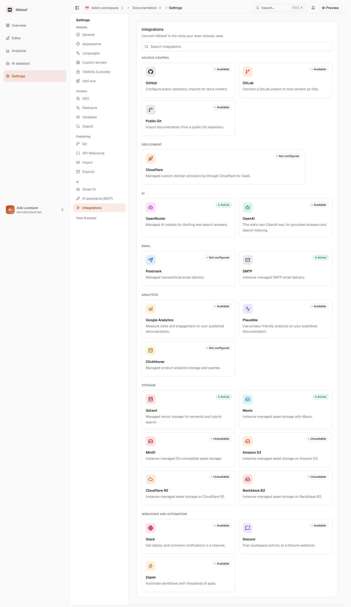

1. **Integrations first, because that's where "connect OpenAI" lives in most products.** The AI group shows OpenRouter
   **"Active"** and OpenAI "Available". "Active" reads as "AI is on". It isn't: the site's AI answers are off. The card
   only means the server has an OpenRouter key (`listAuthorizedProjectIntegrations` adds an `ownership: 'instance'`
   connection whenever `OPENROUTER_API_KEY` is set).
2. **OpenRouter detail** ([shot](ai-and-integrations/shots/cloud-en-1440-02-00-openrouter.jpg)): "Health: Not
   verified", "Credentials: Configured", "Managed by: Nibleaf instance", three model ids in monospace
   (`openai/gpt-6-luna`, `openai/text-embedding-3-large`), then "This provider keeps its existing configuration screen
   and lifecycle." and a button **"Open Git settings"** with a Git icon. It actually opens Smart AI
   (`integrations-tab.tsx:594-610` uses `openGitSettings` for every non-integrations section).
   > *"Is it on or not? What is 'not verified'? Why would AI be in Git settings?"*
3. **Smart AI** ([shot](ai-and-integrations/shots/cloud-en-1440-03-smart-ai.jpg)):

   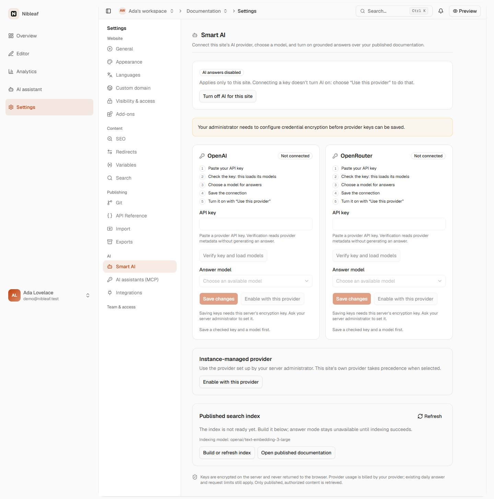

   - The status card says **"AI answers disabled"**, and its only button is **"Turn off AI for this site"**, enabled.
     It is disabled only when `selectedProvider === 'disabled'`, while the default is `'instance'`.
   - An amber banner: "Your administrator needs to configure credential encryption…" On Cloud there is no
     administrator I can ask.
   - Two identical five-step wizards (OpenAI, OpenRouter). Every control is disabled and each one repeats "Saving keys
     needs this server's encryption key. Ask your server administrator to set it."
   - Step 5 says *Turn it on with "Use this provider"*, but the button is labelled **"Enable with this provider"**. The
     same mismatch appears in Arabic («استخدام هذا المزوّد» vs «التفعيل بهذا المزوّد»).
   - The one thing that works on Cloud, **"Instance-managed provider → Enable with this provider"**, is the fourth
     card, below both wizards. On a phone it's ~1,700 px down
     ([ar 390](ai-and-integrations/shots/cloud-ar-390-03-smart-ai.jpg)).
   - "Published search index: The index is not ready yet… Indexing model: openai/text-embedding-3-large". "Index",
     "indexing model" and "answer mode" are our words.
   - Cost: one grey footnote: "Provider usage is billed by your provider; existing daily answer and request limits
     still apply." Which provider? Which limits? Usage says
     ([shot](ai-and-integrations/shots/cloud-en-1440-06-usage.jpg)) "Usage metering isn't turned on for this Nibleaf
     server yet".
4. **I press "Enable with this provider"** ([after](ai-and-integrations/shots/cloud-en-1440-flow-02-after-enable.jpg)):
   a "Saved" toast, the badge flips to **"AI answers enabled"**, and the same page still says *"answer mode stays
   unavailable until indexing succeeds."* So is it on? The badge is computed from the selection, not from whether
   readers can get an answer (`smart-ai-section.tsx:104-111` ignores `index.status`).
5. **Search** ([after](ai-and-integrations/shots/cloud-en-1440-flow-03-search-after-enable.jpg)) has an "AI assistant"
   section with its own **"Grounded AI answers"** switch, now on. It writes the same `search.aiAnswers` flag, and so does
   Smart AI's "Turn off". Below it, a *third* index view says "**Index state unavailable**. The index provider is
   temporarily unavailable", which contradicts Smart AI's "not ready yet".
6. **"Is it working?"** Nothing answers that. There is no "try it" link (only "Open published documentation"), no last
   answer, no count today, and no single status.

**Self-host-like** ([Smart AI](ai-and-integrations/shots/selfhost-en-1440-03-smart-ai.jpg),
[Search](ai-and-integrations/shots/selfhost-en-1440-04-search.jpg)): the same "AI answers disabled" plus an enabled
"Turn off AI". The OpenRouter card in Integrations still says **"Managed AI models for drafting and search answers"**
on a server that has no managed AI. Search's switch is disabled with the right hint ("connect an AI provider … in Smart
AI. Open Smart AI"). That's the one place the journey works.

### 2.2 "I want to use my own OpenAI key instead of the managed one (or OpenRouter)."

1. **Integrations → OpenAI** ([shot](ai-and-integrations/shots/cloud-en-1440-02-01-openai.jpg)): "Available", "This
   site's own OpenAI key…", "This provider keeps its existing configuration screen and lifecycle", **"Open Git
   settings"**. There's no key field: a dead end with a wrong label.
2. **Smart AI → OpenAI card** (self-host, [shot](ai-and-integrations/shots/selfhost-en-1440-flow-03-smart-ai-byok.jpg)):
   five steps and four buttons for one task: paste → "Verify key and load models" → choose model → "Save changes" →
   "Enable with this provider".
   - Each step is a round-trip I must remember to make. The checklist exists to explain why buttons are grey.
   - Replacing a key needs a separate checkbox, "I want to replace this site's stored key."
   - Models are listed by raw provider id, with no hint of cost or speed.
   - Nothing says who pays except the footnote. Nothing says the key ends in …4f2a, when it was added, or whether it
     still works.
3. **OpenAI direct can be refused for a reason I can't see.** If the server's embedding model isn't an `openai/*` one,
   saving fails with "This instance uses an embedding model that requires OpenRouter."
   (`workspace-ai.ts:discoverAiProviderModels`).
4. **A key can silently stop counting.** "Verified" also requires the saved embedding model to equal the server's
   current one. If the operator changes `SEARCH_EMBEDDING_MODEL`, every own key flips to "Not connected" with no
   explanation.
5. **On Cloud** the whole journey is impossible today (no encryption key), yet both wizards are drawn: WORKSPACE-03.

### 2.3 "Connect GitHub so my docs sync."

1. **Integrations → GitHub** ([shot](ai-and-integrations/shots/cloud-en-1440-02-04-github.jpg)): "Configure public
   repository imports for docs content". That's wrong: GitHub supports private repos through the GitHub App. Then
   "This provider keeps its existing configuration screen and lifecycle" and "Open Git settings". This time the label
   is right, but there's still nothing to do on the page itself.
2. **Three cards for one job:** GitHub, GitLab and "Public Git" all say "Available" and open the same Git page.
   Connected or not, a card never says *what* is syncing or when it last synced.
3. **Git** ([shot](ai-and-integrations/shots/cloud-en-1440-05-git.jpg)) is the real home and works. It is also split
   from **Import** (Publishing group), which imports from Git too. That's out of scope here; noted for B3.

### 2.4 "Send publish notifications to Slack/Discord."

1. **Slack card:** "Get deploy and comment notifications in a channel." Detail
   ([shot](ai-and-integrations/shots/cloud-en-1440-02-03-slack.jpg)): fields "Label" and "Webhook URL", and the hint
   "Connect a provider-specific webhook for this site." There's no help on where to get the URL and no choice of events.
2. **Connect** ([connected, self-host](ai-and-integrations/shots/selfhost-en-1440-flow-01-slack-connected.jpg)):
   "Active · Health: Not verified · Credentials: Configured · Managed by: This site · Label: Docs team" (in monospace),
   with buttons Save changes, Deactivate, Send test, Delete. "Active" next to "Not verified" — which one is true?
3. **Then nothing happens, ever.** No code path delivers events. `IntegrationWebhookDelivery` is written only by the
   verification test (`actions/integrations/index.ts:715-860`). Nothing in `apps/worker` or the publish processor reads
   `projectIntegration`, and `@slack/webhook` is imported only by `providers.ts` for the test message. The card's promise
   is false, and the "Active" badge reports a connection that will never be used.
   > *"I connected Slack, published twice, and nobody in the channel saw anything."*
4. **On Cloud without an encryption key,** "Connect" fails after I fill the form, with "This integration isn't
   available on this Nibleaf instance right now." The card said "Available".

### 2.5 "Add analytics (Plausible/GA)."

1. Two cards, Google Analytics and Plausible, both "Available". Either one opens the same combined Analytics form
   ([shot](ai-and-integrations/shots/cloud-en-1440-02-05-google-analytics.jpg)) with GA4, Plausible, consent, campaign
   dimensions and search terms. It works, and it's the best screen in the catalog.
2. Below, under **Analytics**, there's also a **ClickHouse** card ("Managed product analytics storage and queries",
   "Not configured"). An owner reads that as "my analytics aren't configured".
3. After saving, the cards say "Active", but nothing shows *which* property is tracked or whether a pageview has been
   seen.

### 2.6 "Is everything healthy? Can I tell what's broken and how to fix it?"

- **No.** Health words are about our plumbing: Qdrant "Active · Health: Not verified · Collection
  `nibleaf_search_active` · Search runtime: Hybrid · Configured by the Nibleaf operator"
  ([shot](ai-and-integrations/shots/cloud-en-1440-02-02-qdrant.jpg)), Maxio "Active"
  ([shot](ai-and-integrations/shots/cloud-en-1440-02-07-maxio.jpg)), Amazon S3 "Unavailable · Not configured for this
  Nibleaf instance · Instance-managed credentials are never exposed…"
  ([shot](ai-and-integrations/shots/cloud-en-1440-02-06-amazon-s3.jpg)).
- "Not verified" appears on every connected card, because adapters never verify (`health.status: 'unverified'` is
  hard-coded in `adapterConnection`). The one word meant to signal trouble is shown everywhere and means nothing.
- No card ever says what to do. "Unavailable" and "Not configured" have no action and no explanation.
- The open card is component state, not URL state. Back leaves Settings, and a detail can't be linked.

**Arabic** ([integrations 1440](ai-and-integrations/shots/cloud-ar-1440-01-integrations.jpg),
[integrations 390](ai-and-integrations/shots/cloud-ar-390-01-integrations.jpg),
[Smart AI 390](ai-and-integrations/shots/cloud-ar-390-03-smart-ai.jpg)) mirrors correctly and adds the copy problems
in §6. «نسخة Nibleaf» for "instance" and «الذكاء الاصطناعي الذكي» for "Smart AI" read oddly, and «مزوّد تديره
الاستضافة» ("a provider the hosting manages") is the Cloud user's only way in.

### 2.7 Every problem, ranked

| # | Sev | Problem | Where |
|---|---|---|---|
| 1 | P0 | Slack/Discord/Zapier never deliver events, while the cards promise notifications and say "Active" | catalog copy; no worker path |
| 2 | P0 | OpenAI/OpenRouter detail pages are dead ends labelled "Open Git settings" | `integrations-tab.tsx:594-610` |
| 3 | P1 | OpenRouter "Active" while the site's AI is off; "Managed AI models" shown on servers without managed AI | `integrations/index.ts:354-368`, `en.json` |
| 4 | P1 | One flag, two switches (Smart AI and Search) | `smart-ai-section.tsx`, `search-settings.tsx:345` |
| 5 | P1 | "AI answers enabled" when readers can't get answers (index not ready) | `smart-ai-section.tsx:104-111` |
| 6 | P1 | "Turn off AI" enabled when AI is already off | `smart-ai-section.tsx:123` |
| 7 | P1 | On Cloud, two unusable wizards above the only working control; "ask your administrator" copy | Smart AI layout (WORKSPACE-03) |
| 8 | P1 | 10 infrastructure cards a site owner can't act on, with "Not configured"/"Unavailable" | catalog (WORKSPACE-20) |
| 9 | P2 | Five-step, four-button own-key flow; replace-key checkbox; raw model ids | `ProviderCard` |
| 10 | P2 | Three index views that disagree (Smart AI, Search diagnostics, Integrations → Qdrant) | three components |
| 11 | P2 | "Health: Not verified" hard-coded on every adapter card | `adapterConnection` |
| 12 | P2 | Step copy "Use this provider" vs button "Enable with this provider" (en and ar) | `en.json`/`ar.json` |
| 13 | P2 | "AI assistant" names three different things (sidebar, Search section, MCP) | nav, Search |
| 14 | P2 | GitHub described as "public repository imports"; three Git cards for one job | catalog copy |
| 15 | P3 | Integration detail is not in the URL; Back leaves Settings | `IntegrationsTab` state |
| 16 | P3 | Integrations sits in the "AI" nav group | `sections.ts` |

## 3. Why it ended up like this

The screens mirror our implementation, not the site owner's tasks:

1. **The catalog is the server's provider list.** `INTEGRATION_CATALOG` (`packages/shared/src/integrations.ts`) lists
   every adapter the server knows, including the infrastructure the server itself runs on. The dashboard renders every
   entry as a card, so internal words like `lifecycle: managed | adapter`, `ownership: instance | project` and
   `availability: not_configured | unavailable` reach the screen as "Managed by: Nibleaf instance", "Not configured" and
   "Unavailable".
2. **One fact has several homes.** "Are AI answers on?" lives in `project.config.search.aiAnswers` and is written by
   two screens: the Smart AI "Enable…/Turn off" buttons and the Search "Grounded AI answers" switch. "Which AI provider?"
   is shown in three places: Integrations (OpenRouter and OpenAI cards), Smart AI (two key forms and an
   "Instance-managed provider" card) and Search (a note linking to Smart AI).
3. **There is no capability model.** Each screen derives "can this work here?" from its own mix of flags
   (`instanceConfigured`, `instanceAnswersEnabled`, `encryptionConfigured`, `infrastructureConfigured`, catalog
   `availability`). The answers disagree. For example, the OpenRouter card says "Active" while Smart AI says "AI
   answers disabled" (§2.1).
4. **The components are shared, not the tasks.** One `IntegrationDetail` renders every provider. Its generic tiles
   (Health, Credentials, Managed by) and its "go elsewhere" button, which is always labelled "Open Git settings", are
   drawn for providers they don't fit.

## 4. The new information architecture

### 4.1 Principles

- **Start from the job, not the provider.** A page answers one question a site owner actually asks: "Can readers ask
  AI?", "Is my repo syncing?", "Will Slack hear about publishes?"
- **Show only what this person can act on.** A site owner never sees a service they can't change. The server's
  infrastructure is for the server admin, on a page only server admins see.
- **One home per fact, one switch per setting.** Other pages may *show* a fact read-only, with a link to its home.
- **Runtime capabilities decide what is drawn, never the product edition.** Every option comes from a capability the
  server reports at runtime. We never write "Cloud doesn't have X" in the client. A Cloud that adds encryption keys
  starts offering "Your own key" with no client change, and a self-hosted server with an operator AI key offers
  "Nibleaf AI".
- **Plain words.** No "instance", "adapter", "ownership", "credentials", "health", "embedding", "index", "operator" or
  "lifecycle" on site-owner screens. Model ids are shown by name ("GPT-6 Luna"); the raw id appears only on hover/details.
- **Every red state carries its fix.** A failing check names the problem in the reader's terms and puts the one button
  that fixes it on the same row.

### 4.2 Settings navigation

| Group | Today | Proposed |
|---|---|---|
| Website | General · Appearance · Languages · Custom domain · Visibility & access · Add-ons | same + **Integrations** |
| Content | SEO · Redirects · Variables · Search | same (Search keeps search; its AI options move out) |
| Publishing | Git · API reference · Import · Exports | same |
| AI | Smart AI · AI assistants (MCP) · Integrations | **AI answers** · AI assistants (MCP) |

- **Smart AI → "AI answers"** (ar: «إجابات الذكاء الاصطناعي»). The page is named for what readers get, not for the
  setting. `?section=smartAi` keeps working through `RENAMED_SECTIONS` (`features/site-settings/model/ids.ts`), and a new
  id `ai` becomes canonical.
- **Integrations leaves the AI group.** It holds Git, analytics and chat tools, none of them AI. Its new place is the
  Website group (see decision D4).
- The **AI group** is exactly the two AI jobs: answers for readers, and assistants (MCP) for editors.

### 4.3 AI answers: one page

One page answers the four questions in the brief, top to bottom:

| Question | Section | Primitive |
|---|---|---|
| Is AI on for my docs? | **"Let readers ask AI"**: the only switch for AI answers anywhere, with a status badge (On · Off · Not working) | `PageHeader`, `SettingsRow` + `Switch`, `StatusBadge`, `disabledReason` |
| What powers it? | **"What powers AI answers"**: Nibleaf AI · Your OpenAI key · Your OpenRouter key, each drawn only if the server offers it | `RadioField`/`RadioGroup` cards |
| What does it cost? | A line inside the selected option ("Up to 200 answers a day" / "OpenAI bills you…") and the daily meter in the checklist | `Meter`, `Callout tone=info` |
| Is it working? | **"Is it working?"**: published → ready for AI → provider answering → today's answers, each row with its own fix | `DataList` + `StatusBadge` + row action |
| How do I bring my own key? | "Add key" on the option opens one dialog: paste, check, choose model, save | `ActionDialog` |
| What do readers see? | Suggested questions, "Still need help?" link, keep conversations (moved from Search) | `SettingsSection`, `FormField`, `SaveRegion` |

When the server can't serve AI answers at all, `FeatureUnavailable` replaces the whole body (mockup I). A site owner
then sees one sentence and no forms. A **platform admin** also gets the setup hint and the self-hosting guide link.

Search keeps a single read-only row: "AI answers: On · Manage in AI answers →". The Search page stops writing
`aiAnswers`.

### 4.4 Integrations: only what a site owner connects

Integrations becomes a hub grouped by job: **Sync your docs** (GitHub, GitLab or any Git URL), **Analytics** (Google
Analytics, Plausible), **Notifications** (Slack, Discord), and **Automation** (Zapier).

- **Removed from site settings:** Qdrant, ClickHouse, Postmark, SMTP, Maxio, MinIO, Amazon S3, Cloudflare R2,
  Backblaze B2 and Cloudflare. They move to Server status (§4.5).
- **AI providers leave the catalog.** OpenAI and OpenRouter live on the AI answers page only. A pointer row at the end
  of the hub ("Looking for OpenAI or OpenRouter? AI keys live in AI answers") catches people who search here. The
  catalog search also matches "openai", "openrouter", "gpt" and "ai" to that pointer.
- **One card per thing you set up.** Google Analytics and Plausible open the same Analytics form today, so they share
  one detail page that scrolls to the right field. GitHub, GitLab and Git URL cards show the live sync line and open Git
  settings with a correctly labelled button.
- **Card status is binary and plain.** A card either has a status badge (Connected · Paused · Not working) and a status
  line, or a single action button ("Connect" or "Set up"). There is no "Available", "Not configured" or "Unavailable".
- **The open integration lives in the URL** (`?section=integrations&integration=slack`, push), so Back closes it and a
  link can point at it (ui-overhaul §8.4). Today it is component state.
- **Notifications must actually notify.** See decision D1: no publish or comment event is ever delivered today.

### 4.5 Server status: operator infrastructure, read-only, for server admins

The services the server runs on (file storage, search, AI provider key, credential encryption, email, visitor
analytics, custom-domain automation) appear on one read-only **Server status** page, visible only to platform admins
(mockup J). It sits in the dashboard's account area, behind the same platform-admin check the admin app uses
(`isPlatformAdminEmail`, `apps/server/src/routes.ts`). Technical names are allowed on this page because its reader is
the operator. Each row says what the service is *used for* and links to the matching self-hosting guide section. It
never shows secrets, connection strings or internal hosts. See decision D5 for where this page lives.

### 4.6 The capability contract and the model layer

**Server: one capability object per site, beside the data it explains.** It replaces the flags each screen re-derives.
It is returned by `GET /projects/:id/ai` (the renamed workspace-AI overview) and, trimmed, by the integrations list:

```ts
type SiteAiCapabilities = {
  managed: { available: boolean; model?: { id: string; label: string }; dailyAnswerLimit: number };
  ownKey: { available: boolean; reason?: 'credentialStorageMissing' };    // INTEGRATION_CREDENTIAL_ENCRYPTION_KEY
  providers: Array<{ id: 'openai' | 'openrouter'; available: boolean }>;  // e.g. OpenAI direct needs an openai/* embedding model
  answers: { available: boolean; reason?: 'searchNotConfigured' | 'answersDisabledOnServer' };
  viewer: { canManage: boolean; platformAdmin: boolean };                 // platformAdmin only changes help text
};
type SiteAiStatus = {
  enabled: boolean;                          // the one switch
  source: 'managed' | 'openai' | 'openrouter' | null;
  connections: Array<{ id: 'openai' | 'openrouter'; state: 'missing' | 'ok' | 'rejected' | 'unreachable' | 'needsRecheck';
                       keyHint?: string; addedAt?: string; model?: { id: string; label: string } }>;
  published: { version: number; at: string } | null;
  preparation: { state: 'none' | 'running' | 'ready' | 'partial' | 'failed'; pages: number; at?: string };
  usage: { answersToday: number; limit: number; resetsAt: string };
};
```

- The server derives `capabilities` from runtime configuration only: env, Qdrant client and keyring. There is no
  `isCloud` anywhere.
- `keyHint` is the last four characters, stored at save time (decision D7). The key itself never leaves the server.
- Model labels come from a small server-side map (`openai/gpt-6-luna → GPT-6 Luna`), falling back to the id. They are
  `<bdi>`/LTR in Arabic.

**Client: `features/site-ai/{api,model,components}`** (ui-overhaul §7):

- `api/`: query and mutation factories (`siteAiQueryOptions`, `useSaveAiKey`, `useSelectAiSource`, `useSetAiAnswers`,
  `usePrepareDocsForAi`) and route-loader prefetch for `?section=ai`.
- `model/ai.ts` (pure, table-tested):
  - `aiPageState(caps, status, access)` returns `'unavailable' | 'off' | 'on' | 'notWorking'` plus the single headline
    problem.
  - `sourceOptions(caps, status)` returns the radio items to draw, each with a `Decision`.
  - `switchDecision(...)` returns allowed, or denied with a reason key (`'ai.reason.addKeyFirst'`,
    `'ai.reason.publishFirst'`, …).
  - `checklist(status)` returns rows of `{ id, tone, title, detail, fix?: 'replaceKey' | 'prepare' | 'publish' | 'changeModel' | 'seeUsage' }`.
- `components/`: render only. They take model output and never compare roles or flags.

**Integrations: `features/integrations/{api,model,components}`.** The server catalog gains
`audience: 'site' | 'server'`. The site list endpoint returns `audience: 'site'` entries only; the `server` entries
feed Server status. `model/integrations.ts` holds the pure parts: `hubGroups(entries)`, `cardState(entry)` returning
`connected | paused | notWorking | notSetUp` with its line, and `detailDecisions(entry, access)`.

## 5. Screen-by-screen states and copy

The copy is final English. The Arabic notes follow in §6. `{n}` placeholders use the locale's number format.

### 5.1 AI answers

| State | What the page shows | Copy (en) |
|---|---|---|
| **Loading** | `PageHeader` at once (static copy); body skeleton shaped like the page: one switch row, three option cards, four checklist rows (mockup K) | screen reader: "Loading" |
| **Unavailable** (server can't serve answers) | `FeatureUnavailable`, no forms (mockup I) | "AI answers aren't available on this Nibleaf server yet." / "Search on your site still works as usual." Platform admin only: "To turn them on, set up search and an AI provider." + link "Self-hosting guide: AI answers" |
| **Off, Nibleaf AI available** (Cloud-like first visit) | Switch enabled; Nibleaf AI preselected (mockup D, top) | Switch: "Let readers ask AI" / badge "Off" / "Readers only see regular search results." |
| **Off, own key only** (self-host-like first visit) | Switch disabled with a visible reason (mockup D, bottom) | reason: "Add your OpenAI or OpenRouter key below first." |
| **Off, not published** | Switch disabled | reason: "Publish your docs first. AI answers only use published pages." |
| **On, Nibleaf AI** | badge "On", checklist all green (mockup A) | "Readers see “Ask AI” next to search on your published site." Option: "Nibleaf AI" / "Ready to use. Nibleaf runs the model for you." / chips "Model: GPT-6 Luna", "Up to {limit} answers a day" |
| **On, own key** | Selected option shows key hint, model, actions, who pays (mockup B) | chips: "Key works", "Key ending in {hint} · added {date}", "Model: {model}". Buttons: "Change model", "Replace key", "Remove key". Callout: "**Who pays.** OpenAI bills your account for each answer. Nibleaf still stops at {limit} answers a day so a busy day can't surprise you." |
| **Preparing docs** (index running) | Row with progress, "Update now" disabled with reason | "Preparing {pages} pages · about a minute left" / reason: "Already updating." |
| **Not working** (error with fix) | One danger `Callout` at the top naming the main problem + its fix button; badge "Not working"; failing checklist row repeats the fix (mockup C) | "Readers can't get AI answers right now." + the row's sentence (table below) |
| **Removing a key** | `ActionDialog` (destructive) | Title "Remove your OpenAI key?" / "AI answers will switch to Nibleaf AI." *(or, when there is no Nibleaf AI:)* "AI answers will turn off until you add a key again." / button "Remove key" |
| **Turning off** | No confirmation (it's one click to turn back on); success toast "AI answers turned off" | |

Error rows (each is one `DataList` row: icon, sentence, fix button):

| Cause (server state) | Sentence | Fix |
|---|---|---|
| key refused (`rejected`) | "OpenAI refused the key at {time}. Check that it still exists in your OpenAI account." | Replace key |
| provider unreachable | "We couldn't reach OpenAI just now. We'll keep trying; nothing to change on your side." | Check again |
| model withdrawn | "{model} isn't offered by your key any more. Pick another model." | Change model |
| embedding model changed by server (`needsRecheck`) | "Your key needs a quick re-check after a server update." | Check key |
| preparation failed / partial | "We couldn't prepare {n} pages for AI. The rest still work." | Try again |
| not published | "Publish your docs first. AI answers only use published pages." | Publish |
| daily limit reached | "Readers used all {limit} answers today. AI answers come back at {time}; search still works." | See usage |

**Add / replace key dialog** (`ActionDialog`, mockup E):

- Title "Add your OpenAI key" (or "Replace your OpenAI key"). Lead: "Readers' questions will be answered with your
  OpenAI account. OpenAI bills you for usage."
- Steps: "In OpenAI, open API keys and create a key for Nibleaf." (external link) · "Paste it here. We check it with
  OpenAI before saving."
- Field "OpenAI API key" (`SecretInput`, LTR, no autofill). Hint: "Stored encrypted. Nobody, including you, can read it
  back after saving."
- Field "Model". It loads automatically once a key is pasted (debounced, no extra button), with the recommended model
  preselected. Hint: "Faster models cost less per answer."
- One primary button, **"Check and save"**: verify, save, and select this source in one server call. A refusal shows
  inline under the key field: "OpenAI didn't accept this key. Check that you copied all of it."
- OpenRouter is the same with its own wording. A management or provisioning key gets: "That's an OpenRouter
  management key. Create a regular API key instead."

This replaces the five-step checklist, "Verify key and load models", Save, "Enable with this provider", and the "I want
to replace this site's stored key" checkbox.

### 5.2 Integrations hub and details

| State | Copy (en) |
|---|---|
| Loading | Skeleton: 4 group headings × 2 cards, shaped like the hub |
| Load error | `Callout tone=danger`: "Integrations didn't load. Your connections weren't changed." + "Try again" |
| Search, no match | "No integration called “{query}”." + "Looking for an AI key? Open AI answers." when the query looks like AI |
| Card, not set up | name + one-line benefit + button "Connect" (Slack, Discord, Zapier) or "Set up" (Git, analytics) |
| Card, connected | badge "Connected" + live line: "Syncing {repo} · {branch} · {time}", "Tracking with {id}", "Posts to {label}" |
| Card, paused | badge "Paused" + "Not posting. Turn it back on in Slack's settings." |
| Card, not working | badge "Not working" + reason: "Last message didn't arrive: Slack says the link was removed." |
| Slack/Discord connect (`ActionDialog`) | "Connect Slack" / step "In Slack, add an incoming webhook to the channel you want." (link "How to get a webhook URL") / field "Webhook URL" / field "Name (optional)", placeholder "Docs team" / checkboxes "A publish finished", "A publish failed" / primary "Connect and send a test" / under it: "We'll post a short test message to that channel." |
| Detail, connected | mockup G: "What to post" switches · "Recent messages" (last 5 deliveries with time and result) · rows: "Send a test message", "Pause", "Replace URL", "Disconnect" |
| Disconnect | `ActionDialog` destructive: "Disconnect Slack?" / "Nibleaf stops posting to {label}. You can connect again any time." / "Disconnect" |

Words that go: Activate/Deactivate (→ Pause/Resume), Verify (→ Send a test message), Health, Credentials, Managed by,
Configuration, "provider", "webhook" as a section title, "Label" (→ Name).

### 5.3 Server status (platform admins)

Columns: Service (plain name + technical name) · Used for · Status (Working · Not set up · Off · Not responding) ·
Guide. The rows are in mockup J. A "Not set up" row with consequences for site owners spells them out, for example
"Saving site keys: sites can't add their own AI key, Slack or Discord until this is set."

## 6. Arabic notes

- **"Smart AI" today is «الذكاء الاصطناعي الذكي»**, literally "the smart artificial intelligence". New name:
  «إجابات الذكاء الاصطناعي». Switch label: «السماح للقرّاء بسؤال الذكاء الاصطناعي».
- **"Nibleaf instance" is «نسخة Nibleaf»** ("a copy of Nibleaf"), which reads as a version. On site-owner screens the
  word disappears. On Server status use «الخادم» (the server).
- **"Webhooks and automation" is «خطافات الويب والأتمتة»**, a literal calque. Use «الإشعارات» and «الأتمتة» as the
  group names. The field stays «رابط Webhook» because users copy it from Slack in English.
- **Product and model names** (Nibleaf, OpenAI, OpenRouter, GPT-6 Luna, Slack) stay Latin inside `<bdi>`. Key hints
  ("…4f2a") and URLs are LTR-isolated.
- **Numbers** use the locale's `Intl.NumberFormat` («٣٧ من ٢٠٠»), the same as the rest of the dashboard. Times use
  relative formatting («منذ ساعتين»).
- **Mirrored UI:** the back arrow points right («→ كل الإعدادات»), switches fill from the right, and the checklist
  icons sit at the start (right).
- **"Who pays":** «من يدفع» reads naturally. Avoid «فوترة» on site-owner screens.
- **"Prepared for AI"** (replacing "index"): «جاهز للذكاء الاصطناعي». Avoid «فهرس» and «تضمين» ("embedding").
- Existing Arabic strings mix «مزوّد» and «المزوّد الخارجي» for "provider". The new copy names the company instead
  (OpenAI, Slack) and never says "provider".

## 7. Mockups

Low fidelity on purpose: they fix order, states and words, not visuals. The source is
[`mockups.html`](ai-and-integrations/mockups.html). Purple notes name the primitive or the rule behind an element.

| | |
|---|---|
| A. AI answers, on, Nibleaf AI 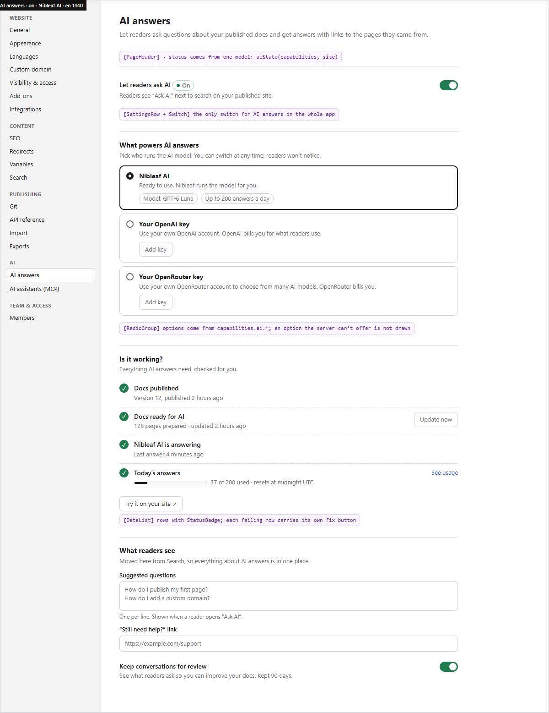 | B. Own OpenAI key connected 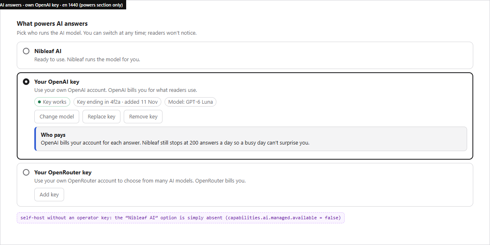 |
| C. Not working, with the fix 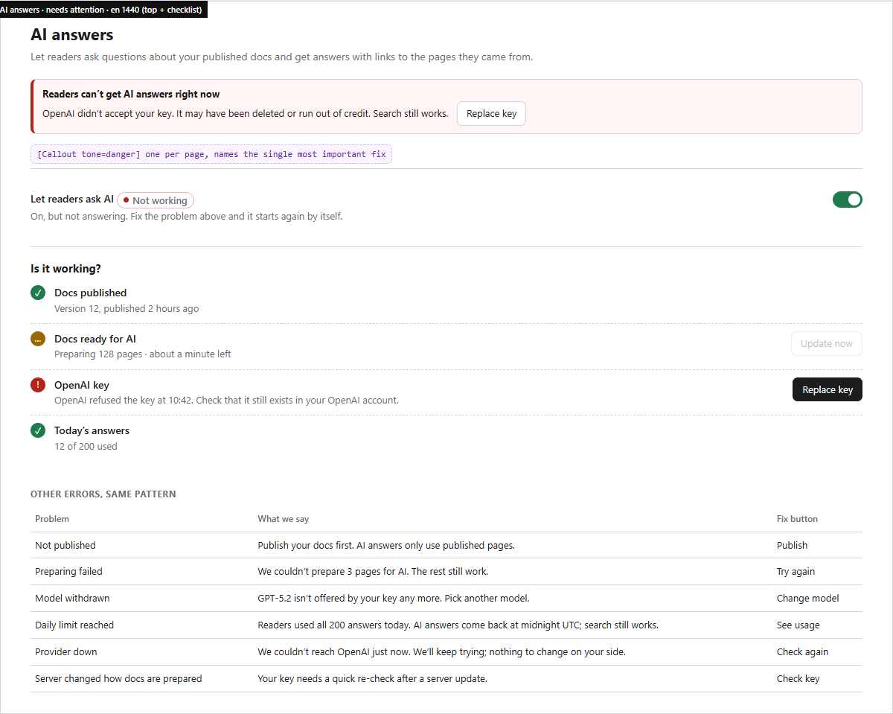 | D. Off, first visit (both server types) 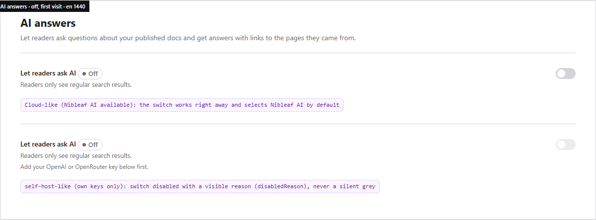 |
| E. Add your key dialog 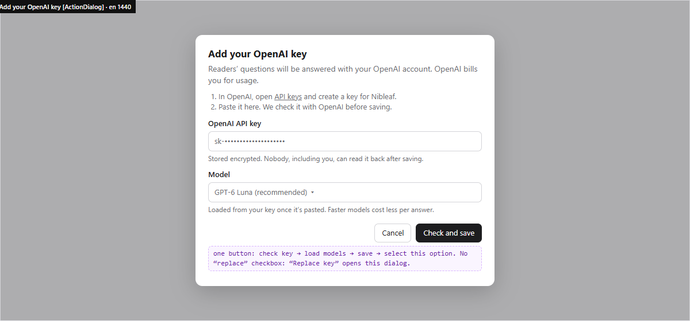 | F. Integrations hub 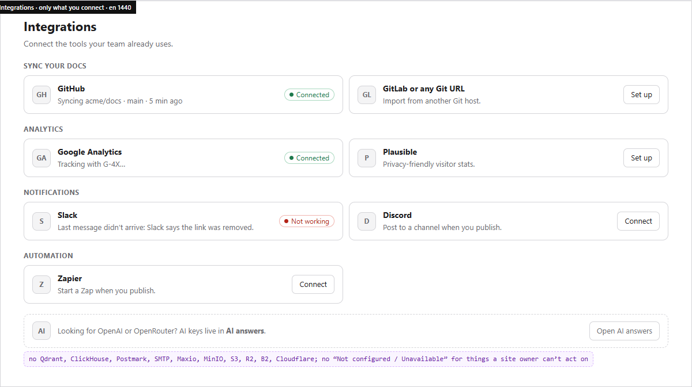 |
| G. Slack, connected 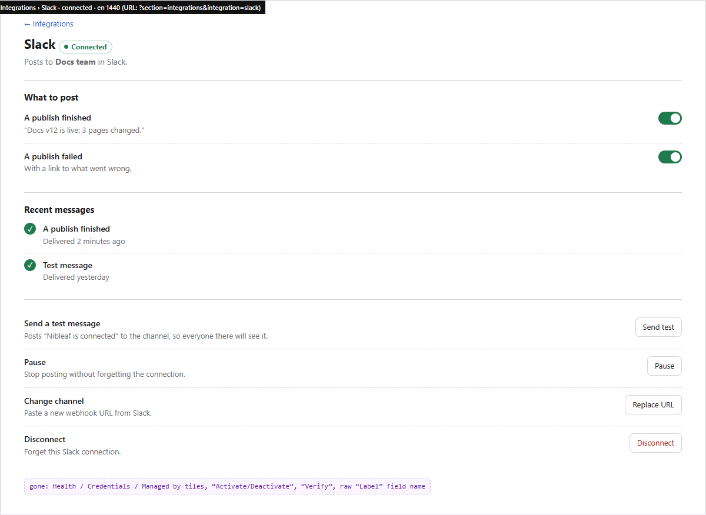 | H. Arabic, 390 px 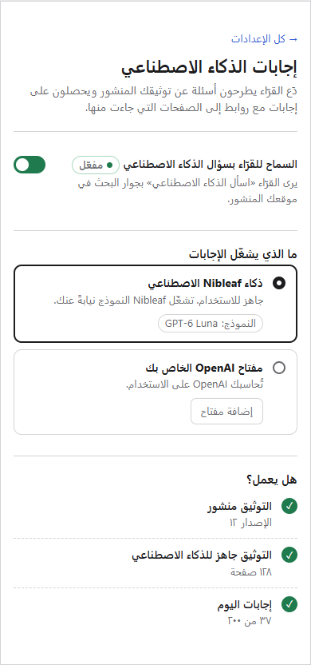 |
| I. Not available on this server 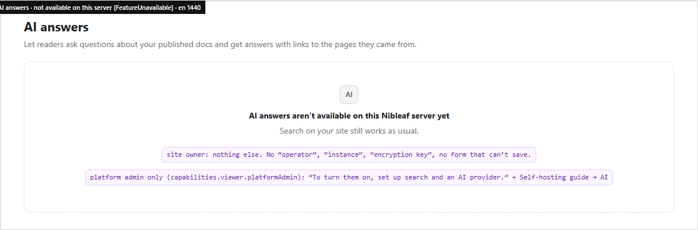 | J. Server status (platform admins) 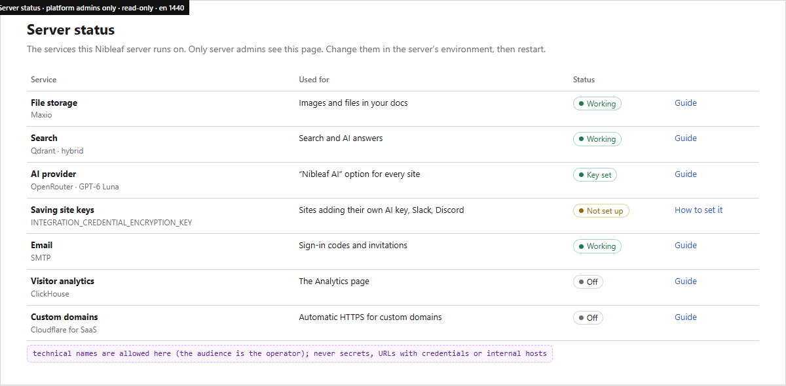 |
| K. Loading 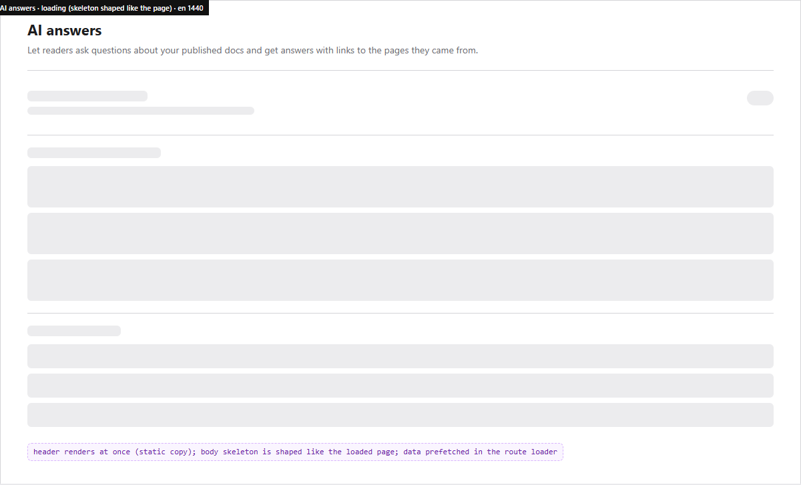 | |

## 8. PR plan

Each PR is small, ships behind no flag, and keeps old links working. Every PR meets ui-overhaul §10: before/after at
1440 and 390, EN and AR, light and dark; all states present; keyboard and a11y checks; touched-package suites green
before push.

| # | PR | Content | Acceptance checks |
|---|---|---|---|
| 1 | `fix(integrations): label the AI providers' link and stop showing "Active" for AI that is off` | Hot fixes that need no IA: the detail button for `settingsSection: 'smartAi'` says "Open Smart AI" with the right icon. The operator OpenRouter entry no longer reports `status: active` unless this site actually uses it. Smart AI's "Turn off AI" is disabled with a reason when AI is already off. | No "Open Git settings" on AI pages · OpenRouter card status matches Smart AI's badge in all 4 combinations (operator key ± site on) · test per combination |
| 2 | `feat(ai): site AI capabilities and status` (server + `features/site-ai/{api,model}`) | `GET /projects/:id/ai` returns `capabilities` + `status` (§4.6) with model labels, `keyHint` (new column, filled on next save), today's answer count; `aiPageState`, `sourceOptions`, `switchDecision`, `checklist` pure + table tests. No UI change. | Table tests cover every row of §5.1 · no secret or key prefix in any response or log (test) · no `isCloud`/edition branch (grep check in test) · old `/workspace-ai` route still served |
| 3 | `feat(ai): one AI answers page` | New page on the PR 2 model: switch, source radio cards, checklist, `FeatureUnavailable` (created here if B4 hasn't landed it), loader prefetch; nav rename and `smartAi → ai` redirect; Search's AI switch becomes the read-only row. | Exactly one control in the app writes `aiAnswers` (test) · all §5.1 states rendered in a story/test · `?section=smartAi` opens the page · screenshots for both server types |
| 4 | `feat(ai): add your own key in one step` | `ActionDialog` add/replace/remove for OpenAI and OpenRouter; server `saveAndSelect` endpoint (check → save → select atomically, revision-checked); auto model load; friendly labels. Removes the five-step card. | Key never in URL, query cache, logs or error text (tests) · refusal shown inline under the field · keyboard: Enter submits, Esc cancels, focus returns to "Add key" · replace keeps the old key on failure |
| 5 | `refactor(search): move reader AI options to AI answers` | Suggested questions, "Still need help?" link and conversation capture move to the AI page; Search shows the link row. | Values unchanged after the move (migration-free: same config keys) · Search page has no AI fields · both pages' save regions work independently |
| 6 | `refactor(integrations): only what site owners connect` | Server catalog `audience`; site endpoint returns site entries only; AI providers removed (pointer row instead); hub grouped by job; plain card states; URL state for the open integration; analytics merged into one detail. | No infrastructure provider appears for any site role · search "openai" finds the pointer · Back closes a detail · `?section=analytics` still lands on analytics · `?integration=<unknown>` falls back to the hub |
| 7 | `feat(integrations): post publish results to Slack, Discord and Zapier` | Worker emits `publish.succeeded` / `publish.failed` to active connections through the existing `IntegrationWebhookDelivery` ledger (idempotent, retried, bounded); per-connection event choice; "Recent messages" on the detail. | A publish posts exactly once per connection (idempotency test) · failures mark the card "Not working" with the reason · paused connections receive nothing · no webhook URL in logs |
| 8 | `feat(account): server status for platform admins` | Read-only page (§4.5), platform-admin gated on the server; links to self-hosting guide anchors. | 403 for non-admins (test) · no secrets, hosts or connection strings in the payload (test) · every row has "Used for" text |
| 9 | `chore(i18n): AI and integrations copy in every locale` | Remove dead keys (`settings_integrations_*` for removed screens, `smartAi.step.*`), add the new ones in all 12 locales; Arabic review per §6. | `pnpm --filter @nibleaf/i18n run setup` clean · no unused keys (knip) · ar screenshots reviewed |

Order: 1 → 2 → (3, 6 in parallel) → 4 → 5 → 7 → 8 → 9. PR 1 can ship today. PR 7 depends on decision D1. PRs 3–6
belong to ui-overhaul B4 ("AI assistants, integrations, Smart AI, exports") and replace its Smart AI and integrations
part.

## 9. Decisions for the owner

| # | Decision | Options | Recommendation |
|---|---|---|---|
| D1 | **Slack/Discord/Zapier deliver nothing today.** What do we show until PR 7 ships? | (a) hide the Notifications and Automation groups behind a server capability `integrations.events` until delivery exists; (b) keep the cards with "Coming soon"; (c) leave as is | **(a) now, then build PR 7** (publish finished/failed only). A card that connects but never posts is worse than no card. Comment events can come later. |
| D2 | **Rename "Smart AI" to "AI answers"** (ar «إجابات الذكاء الاصطناعي») | keep "Smart AI" / "AI answers" / "Ask AI" | **"AI answers"**: it names what readers get, matches the reader's "Ask AI" button, and fixes the Arabic. |
| D3 | **Move reader AI options** (suggested questions, support link, save conversations) from Search to AI answers | move / keep in Search | **Move.** Search keeps a read-only status row linking to AI answers. One home per feature. |
| D4 | **Where Integrations goes** once it leaves the AI group | Website group / own "Connections" group / Publishing | **Website group**, after Add-ons. Both extend the site, and it avoids a one-item group. |
| D5 | **Where operators see infrastructure** | (a) a platform-admin-only "Server status" page in the dashboard; (b) the admin app only (opt-in profile in `docker-compose.prod.yml`, absent from the self-host `docker-compose.yml`); (c) both | **(a)**: most self-hosters never run the admin profile. Mirror it in the admin app later if wanted. |
| D6 | **Can site owners pick the model on Nibleaf AI?** | operator-fixed model / curated short list | **Operator-fixed for now**, shown by name. Revisit with pricing. |
| D7 | **Store a key hint** (last 4 characters) and the date added | store / don't | **Store.** It's the only way an owner can tell which key is in use, and 4 characters of an API key are not a usable secret. |
| D8 | **What do we say about cost on Nibleaf AI?** | "Included in your plan" / "Up to {limit} answers a day" / nothing | **"Up to {limit} answers a day"** plus the meter, with no money claims until Cloud billing for AI is final. The owner should confirm whether Nibleaf AI is included in every plan. |
| D9 | **On Cloud, offer "Your own key"?** | depends on Ops setting the encryption key | **Let the capability decide.** Once Ops sets `INTEGRATION_CREDENTIAL_ENCRYPTION_KEY` on Cloud, the option appears with no code change. Until then it isn't drawn (no "ask your administrator"). Ops should confirm the key is planned. |
| D10 | **What does "Let readers ask AI" do while docs are still being prepared?** | switch on immediately and show "Preparing…" / block the switch until ready | **Switch on immediately**, start preparing automatically, and show "Preparing your docs for AI" until ready. The owner's intent is recorded, and they don't have to come back. |

## 10. Out of scope, and risks

- The editor's AI drafting (`AI_DRAFT_MODEL`) and the dashboard "AI assistant" page (reader conversations) aren't
  changed here. The names are, though: "AI assistant" should mean only one thing. Proposal: rename the sidebar page
  "Reader questions" in B6.
- **Risk: the capability endpoint becomes a new god-object.** Mitigation: it describes *this site's AI only*.
  Integrations gets its own `audience` filter, and Server status its own endpoint.
- **Risk: removing infrastructure cards hides useful health from operators who relied on them.** Mitigation: PR 8
  (Server status) ships in the same milestone as PR 6, and PR 6's description links to it.
- **Risk: automatic preparation on enable (D10) costs embedding tokens on an own key.** Mitigation: the own-key dialog
  says so ("Preparing your docs uses a small amount of your OpenAI credit.").
