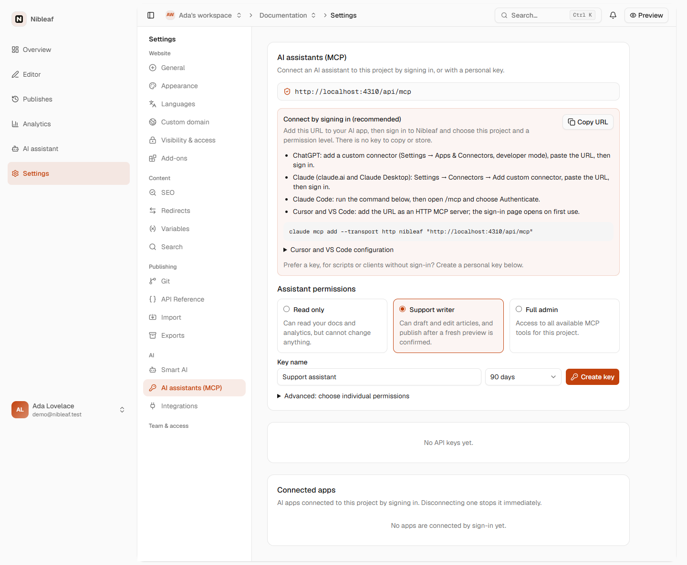
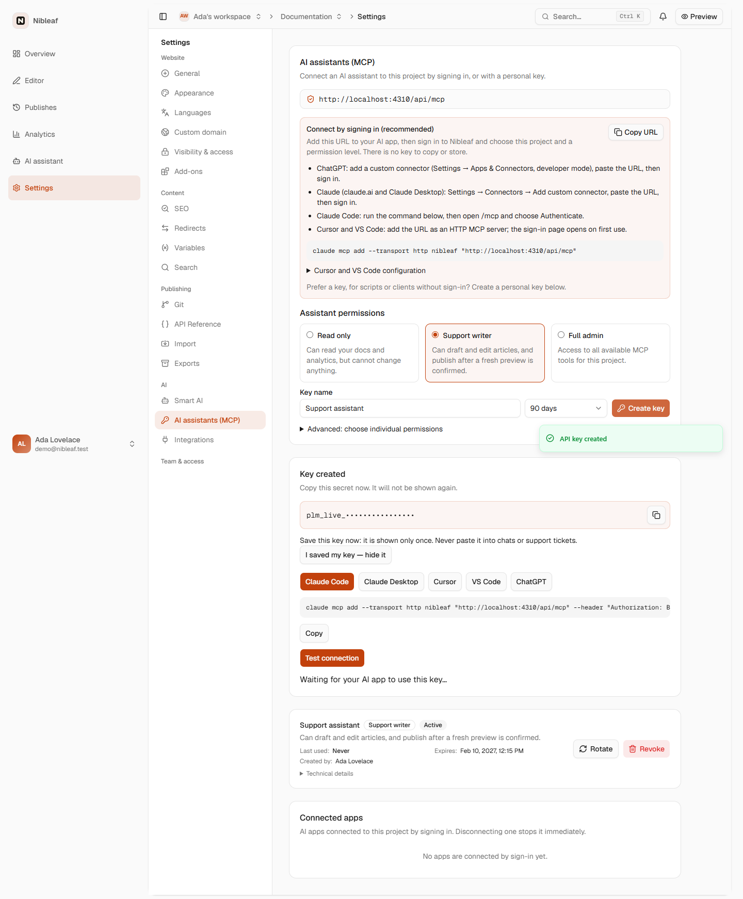
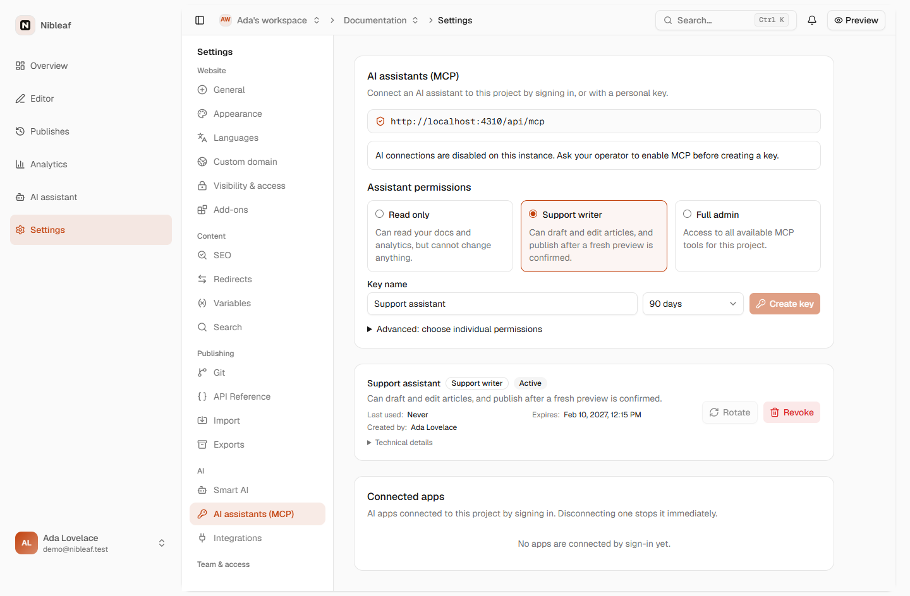
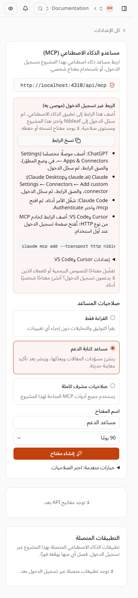

# AI assistants (MCP), from the user's side

Status: **plan, after one Sol council (§10); waiting for the owner's decisions in §8.** Phase B follows the PR plan in §7.
Scope: everything a person touches to use Nibleaf from ChatGPT, Claude, Claude Code, Cursor or VS Code. That covers
Site settings → AI assistants (MCP), the sign-in pages (`/oauth/project`, `/oauth/consent`), what the assistant says
back to the person (tool results and server instructions), and the docs. Assets are in [`mcp/`](mcp/).

The owner asked to *"improve ui/ux of mcp, and add docs, and how our users can use mcp to communicate with nibleaf
properly"*. The owner had already said our AI and integrations UI is illogical and that we aren't seeing it from the
user's perspective. This plan therefore starts from what people come to do (§2) and only then turns to the screens
(§3–§4). It follows the principles of the AI and integrations plan
([`ai-and-integrations.md`](ai-and-integrations.md) §4.1): start from the job, show only what this person can act on,
let runtime capabilities decide what is drawn, use plain words, and put the fix next to every red state.

## 0. Summary

- **The server is good, but the page around it is a key generator.** Behind `/api/mcp` are 45 tools, 5 prompts,
  drafts-only writes, publishing only after a confirmed preview, a live role check on every call, and an audit
  trail. The settings page, though, opens on a bare URL with no label and shows a key form that is always expanded.
  A one-time secret panel follows, then an untitled key list, then a second list (Connected apps). Nothing on the
  page says what you can *ask* an assistant once it's connected.
- **The recommended path, signing in, is a block of bullets; the key path is the page's main form.** The connect
  steps for five clients are squeezed into one box, and four of them are prose. Neither path ever confirms that a
  signed-in app actually connected. Only keys get the "waiting for your AI app" check.
- **"Off" is a dead page.** Production runs `MCP_ENABLED=false`. Every Cloud user who opens the tab sees the endpoint,
  three permission cards and a key form, all live, plus a disabled **Create key** button and a line that tells them to
  "Ask your operator". Cloud users have no operator they can ask.
- **The assistant can't hand you back to the dashboard.** A draft created from Cursor returns no editor link. The
  publish preview gives the published site URL, but not the publish dialog. The writer's "draft there, review here"
  job has no bridge.
- **Read-only access needs edit rights.** MCP refuses Viewers (`MCP_SCOPE_MIN_ROLE`, every scope is `MEMBER`). A
  support lead who wants to give a teammate read-only AI access must make them an Editor. An Editor can create a
  **Support writer** key and publish.
- **One connection per website, and the URL is the same for every website.** In a client that keys connectors by URL,
  someone with three websites can't keep three connections side by side. The sign-in picker calls websites
  "projects". It shows each one's organization and slug, but as one flat list.
- **Reporting needs publishing rights.** "What do readers fail to find?" needs `analytics:search_terms`, which only
  **Support writer** (drafts and publishing) or a hand-picked key includes. A support analyst has no read-only way to
  get it.
- **The docs are thorough but read like a reference.** `product/ai-assistants.mdx` has 531 lines, presets before
  setup, and no "try asking this" section. `self-hosting/mcp.mdx` says the production Compose file doesn't pass the
  write and publish rate limits. It does (`docker-compose.coolify.yml:87-91`). The README still says "read-only MCP".
- **Proposal:** one page with three parts: **Connect** (choose your app, sign in), **Try asking** (prompts that map to
  real tools), and **Connections** (one list for apps and keys, with activity). Keys move into a dialog. The off state
  becomes a single runtime-driven card. Tool results start carrying dashboard links. The docs become a task-first
  guide plus a reference page, in English and Arabic. That's 3 PRs, plus up to 3 more that each depend on an owner
  decision (§7).
  Decisions are in §8.

## 1. How this was checked

- `origin/main` at `234381354`. Code read: `apps/server/src/mcp/*` (server instructions in `server.ts:31-36`, prompts,
  write and publish results), `apps/server/src/actions/api-keys.ts`, `packages/shared/src/mcp.ts`, and
  `apps/app/src/components/settings/{api-keys-tab,connected-apps,assistant-setup}.*`. Also
  `apps/app/src/components/oauth/mcp-oauth-steps.tsx`, `features/site-settings/model/sections.ts`, the `en` and `ar`
  messages, both docs pages in both languages, the Compose files and `operations/deploy-6-runbook.md` §6.
- Screenshots of today's tab are in [`mcp/shots/`](mcp/shots/). They were taken on a local stack (ports 4310/4410, an
  isolated compose project, the seeded "Documentation" site and the demo Admin), in EN and AR, at 1440 and 390 px,
  with MCP on and with MCP off. Names follow `<on|off>-<locale>-<width>-<step>.png`. The one-time secret is masked.

| | |
| --- | --- |
| MCP on, EN 1440: the URL without a label, the sign-in block as prose, the key form always open  | After **Create key**: the secret panel, client tabs, the command overflowing, then the untitled key list  |
| MCP off, EN 1440: the endpoint, live permission cards, a disabled **Create key** with no reason, "Ask your operator"  | MCP on, AR 390: English menu paths inside Arabic bullets turn into bidi soup («Settings ← Connectors ← Add custom connector»)  |
- The sign-in pages (`/oauth/project`, `/oauth/consent`) weren't captured: they need a signed request started by a
  client. PR B captures them through a local OAuth client.
- I didn't connect a real ChatGPT or Claude account, and no request went to any outside service. The client
  behaviour I describe (how ChatGPT and claude.ai key connectors, how OAuth tokens are stored) comes from their
  public docs. Phase B has to confirm it with a real client on a staging URL (§6).

## 2. User jobs, end to end

Each job lists the steps today, where it breaks, and the target flow.

### J1. "Connect Claude or ChatGPT to my site and ask what readers fail to find" (docs owner, Admin)

**Today**
1. Find the page. Nothing on the Overview or the AI page mentions assistants. The person has to guess Settings → AI →
   "AI assistants (MCP)". "MCP" means nothing to most docs owners.
2. The page opens on a bordered box holding `https://…/api/mcp` and a shield icon. There's no label, and nothing
   says what to do with it.
3. Next comes "Connect by signing in (recommended)" with four bullets. ChatGPT's bullet says "Settings → Apps &
   Connectors, developer mode", inline in prose. A Claude Code command follows, but no ChatGPT or Claude steps
   with a copy button beside them.
4. The person adds the URL in ChatGPT and signs in. The picker says "Choose a project". The dashboard calls the same
   thing a "website". Each row shows the organization and slug, in one flat list. The person picks one and a
   permission level, then **Allow**.
5. Back in the dashboard, nothing changes until a reload. The new app then appears in **Connected apps**, far down
   the page, below the key form and the empty key list.
6. In ChatGPT the person faces an empty chat. Nothing told them what to ask. If they ask "what are readers failing
   to find?" on a **Read only** connection, `get_failed_searches` isn't available. The read-only preset leaves out
   `analytics:search_terms` (`MCP_PRESET_SCOPES`). The assistant says it can't, and the person doesn't know why.

**Breaks:** discoverability (1), an unlabelled mechanism up front (2), the main path written as prose (3), a naming
mismatch (4), no confirmation that it worked (5), and no next step, with a preset that silently can't do the headline
job (6).

**Target**
1. The Overview, the AI page and Settings each offer "Use this site from ChatGPT or Claude" (§3.3).
2. The page opens with **Connect an assistant**: a row of app choices (ChatGPT · Claude · Claude Code · Cursor ·
   VS Code). Each choice shows 2–3 numbered steps with the URL and **Copy** on the exact step where you paste it.
3. The sign-in page says "Choose a website", grouped under organization headings (it already shows the org per row).
   Each permission level states the headline jobs it allows: "Read only: reports, page reads, saved Ask AI
   questions and answers." With D2, Read only has an opt-in "Include what readers searched for", so the reporting job
   never requires publishing rights.
4. The page watches for 10 minutes after **Copy**. It first records the grants that already exist, then shows two
   steps for a *new* grant on this website by this person: **Authorized** ("ChatGPT was allowed to use *Docs*") once
   the grant exists, and **Working** only after that grant makes a successful MCP call. App names are self-reported,
   so the UI never claims more than "an app named ChatGPT", and the unverified marker from consent stays visible.
   Then: "Try asking: …", with three prompts copyable for the chosen permission.
5. When analytics can't answer (relational analytics has no search text), the assistant says that, not "ask for a
   bigger permission". `get_capabilities.unavailable` distinguishes the *permission* gaps from the *data* gaps.
6. **Try asking** stays on the page as a short list. Each prompt says which permission it needs.

### J2. "Draft and translate a page from Cursor, then review and publish in the dashboard" (writer, Editor)

**Today**
1. Connecting: either Cursor's sign-in through the editor config shown under a `<details>`, or a key. The key path
   means expanding nothing, because the form is always open. The person names the key (the placeholder says
   "Production deploy key"), picks a preset and an expiry, creates it, copies the secret, picks the Cursor tab, sets
   an environment variable, and installs.
2. In Cursor: "draft a page about SSO". `create_page_draft` returns ids and a revision. Translating it to Arabic
   (`translate_page`) works the same way.
3. The writer wants to see the draft. The result has no link. They open the dashboard, find the site, open the editor
   and look for the page.
4. The page history doesn't show that an assistant made the change. The revision is recorded as the person, and only
   the deployment message names the key.
5. The writer publishes, either from the dashboard or by asking Cursor. `preview_publish` returns a summary, the
   published site URL and a token. Then `publish_changes`.

**Breaks:** the key path is long and leaks into shell history or env setup when sign-in would do (1), there's no
bridge back to review (3), and nothing in the editor says "changed by your assistant" (4).

**Target**
1. Cursor's choice on Connect shows the one-click **Add to Cursor** link with the URL only (sign-in). A key is the
   fallback, behind "Use a personal key instead".
2. Write results gain `reviewUrl`, the editor deep link for that page and language. `preview_publish` gains
   `publishDialogUrl`, and `publish_changes` gains `deploymentUrl`. The server instructions tell the assistant to
   share these links. "Draft created. Review it here: …/editor?page=…"
3. Page history labels revisions made through MCP: "Raed, via Cursor". The server already knows the credential at
   write time. This is a follow-up (§9), not part of the first PRs.

### J3. "Give a teammate read-only access" (support lead, Admin)

**Today:** connections belong to whoever made them. An Admin can't create a key *for* someone else, and that's
correct. The teammate has to connect their own assistant, which needs `MEMBER` (Editor) or higher. Viewers don't see
the tab at all (`VIEWER_SECTIONS`), and the server refuses them. So "read-only AI access" means making the teammate an
Editor. As an Editor they can pick **Support writer** and publish. Nothing lets an Admin cap what teammates'
assistants may do on a website.

**Target:** see D2 and D3. With them, the Admin invites the teammate as a **Viewer**. The Viewer opens Settings → AI
assistants, sees **Read only** as the only choice (optionally with search terms, D2), and connects. The Admin sees the
connection in **Connections**, with its owner and its last activity. For this, the key and connected-app routes
(`modules/app/api-keys/routes.ts:7`, `modules/app/connected-apps/routes.ts:7`) must accept Viewers for their *own*
credentials, with ownership tests. Consent and the permission card say plainly that Read only includes saved Ask AI
questions and answers. A Viewer can already read those in the dashboard (`ai-conversations/routes.ts:7` is an any-role
guard), so this discloses them rather than widening access.

### J4. "Audit and revoke connections" (Admin)

**Today:** two lists, **keys** (untitled) and **Connected apps**, with different columns and different actions. Each
row shows the latest activity and a "Technical details" disclosure. Revoked and expired keys stay in the list,
interleaved with live ones. No view spans websites.

**Breaks:** "which assistants can touch this site, and what did they do?" needs two lists. Dead rows add noise. An
organization admin with five websites has to visit five settings pages.

**Target:** one **Connections** list per website. Each row is either an app (signed in) or a key: the person, the
permission, last used, the latest activity, and one action (**Disconnect** or **Revoke**; **Rotate** for your own
key). Live connections come first. Expired, revoked and "needs rotation" rows sit under a collapsed "Inactive (n)".
Rows can be filtered by person. A cross-website view for organization admins is a follow-up (§9).

### J5. "I have several websites in one organization"

**Today:** each connection is bound to one website, and that's the safety model: tools never take a project as
authority. Every website shares the URL `<APP_URL>/api/mcp`, though, and the OAuth audience is that exact URL. A
client that keys connectors by URL can't hold "Docs" and "Blog" at once. Connecting again with another website
replaces what the client holds. The old connection stays listed, unused, on the first website. The sign-in picker
shows "organization · slug" under each name, but as one flat list.

**Target now (PR A and B):** the copy states the rule ("Each connection works on one website. To use another, connect
again and choose it"). The picker gets organization headings and keeps the identity warning and the return address.

**Target later (D1):** the owner chooses the *experience*. Engineering proves feasibility before anything ships.
Option (b), one URL per website (`<APP_URL>/api/mcp/w/<siteId>`), would need a written security contract first:
- discovery metadata per path;
- token audience equal to that exact URL;
- DPoP `htu` equal to it;
- the authorization request's `resource` signed through consent and stored on the grant;
- grant website = path website = key website on every request, with cross-website rejection tests for keys and OAuth;
- refresh keeps the binding;
- the legacy `/api/mcp` URL keeps working.

Today audience and DPoP use one fixed URL (`packages/auth/src/mcp-oauth.ts:315`, `:341`), and the grant takes a
separately chosen website (`apps/server/src/actions/mcp-oauth.ts:113`). Pre-selecting a website alone would bind
nothing.

### J6. "MCP is off on the instance, or my role is too low"

**Today**
- **Off** (production today): the endpoint, the sign-in block (hidden) and the full key form all render. The preset
  cards can be clicked, and **Create key** is disabled without saying why. The status line says "Ask your operator to
  enable MCP". Cloud users have no operator to ask.
- **Sign-in unavailable** (not HTTPS): the sign-in box says so, but the clients that *only* sign in (ChatGPT and the
  claude.ai connectors) still show as choices further down, in the key panel.
- **Viewer:** no tab and no explanation. The person never learns the feature exists.
- **Editor:** sees **Full admin** greyed out with "Available to admins only". That's fine.

**Target:** one card per state, driven by runtime capabilities (`meta.mcpEnabled`, `meta.mcpOAuthEnabled`) and never
by edition.
- **Off:** "AI assistants aren't available on this server yet." Platform admins get a link to the self-hosting guide.
  No endpoint and no form.
- **No sign-in:** clients that need sign-in show "Needs a secure (HTTPS) address", disabled. The key route becomes the
  main path.
- **Viewer:** see D2. If D2 is declined, Viewers see the tab read-only, with "Ask an admin for Editor access to connect
  an assistant".

### J7. "Renew, upgrade or replace a connection" (anyone)

**Today**
- **Key expires tomorrow:** nothing warns. The row shows the date, and nothing else.
- **Rotate an active key:** the old key stops at once. The new one keeps the old expiry (`api-keys.ts:102`), so
  rotating doesn't extend a key's life. The confirm dialog says so, and the row doesn't.
- **Expired or legacy key:** rotation issues a new 90-day key. The row sits in the list next to live keys, so the
  person has to spot it.
- **More or less permission for a signed-in app:** there's no "change permission". The person reconnects from the
  app, which replaces their earlier grant for the same app and website. That isn't said anywhere.
- **Replace credentials in the client:** after rotation, the snippet panel is shown again, but only to whoever
  rotated.

**Target:** rows due to expire within 7 days get "Expires in 3 days · Rotate" (owner only). **Inactive** keeps
**Rotate** on expired and legacy keys, so recovery stays one click away. Rotation copy states "Same expiry date. To get
a longer key, create a new one." Signed-in rows get "Change permission", which explains that you reconnect from the
app, with the app's steps from Connect. After rotation, the panel shows the new snippet for the app the key was set up
with.

### J8. "Something went wrong" (anyone)

**Today:** the assistant gets precise errors (`mcp:revision_conflict`, `mcp:preview_stale`, `http:rate_limited` …),
and the docs explain each one. In the dashboard, the latest activity line names blocked calls in plain words ("Blocked:
this app can't publish"), which is good. The person who hit the error is in the chat, though, not on the settings
page.

**Target:** the guide's troubleshooting starts from what the person *sees in the chat*, not the error code ("The
assistant says it can't publish" → your permission). The activity line links to the matching docs anchor.

## 3. Information architecture

### 3.1 Where it lives

| Level | What lives there | Why |
| --- | --- | --- |
| **Website** → Settings → AI → **AI assistants** | Connect, Try asking, Connections (this person's; everyone's for Admins) | Credentials are bound to one website and capped by the website role. That's the security model, and it stays. |
| **Organization** → Settings | Nothing in Phase B. Later: a read-only "AI connections" audit across websites for org admins (§9) | Billing and members live at org level, but an MCP credential never spans websites. |
| **Account** | Nothing in Phase B. Later: "Your connected AI apps" across every website (§9) | Useful once people hold connections on many websites. |

The page stays in the **AI** group, as the AI and integrations plan already decided (§4.2: "the AI group is exactly the
two AI jobs: answers for readers, and assistants (MCP) for editors").

### 3.2 Naming

- **Nav and title:** "AI assistants" (ar «مساعدو الذكاء الاصطناعي», the current title without "(MCP)"). Drop
  "(MCP)" from the nav. The subtitle keeps it for people who search for it: "Use this website from ChatGPT, Claude, Cursor or VS Code. Works with any MCP app."
- **One word per thing:** "website", not "project", in every user string, including the sign-in and consent pages
  (`oauth_project_*`, `oauth_consent_*`). "Connection" means one app or key. "Permission" replaces "preset" and
  "scope" on screen. Raw scope ids appear only in **Technical details**.
- **Collision:** the sidebar page "AI assistant" holds reader conversations. The AI and integrations plan proposes
  renaming it "Reader questions" (§10, backlog B6). This page relies on that rename, and PR A should land it if B6
  hasn't.
- **Permission names:** keep **Read only** / **Support writer** / **Full admin** (they're in tokens, docs and audit
  rows). Fix the Arabic so the three read as capabilities, like «القراءة فقط»: «مساعد كتابة الدعم»
  ("support-writing assistant") becomes «الكتابة والنشر بعد المراجعة». «صلاحيات مشرف كاملة» stays.

### 3.3 Discoverability

- **Overview:** after the first publish, the "What's next" area gets one card: "Ask ChatGPT or Claude about this
  website: what readers can't find, drafts, translations" → the page. It shows only when `mcpEnabled` and the person
  can connect. The Overview belongs to the editor lead, so we coordinate before PR A touches it.
- **AI page (reader questions):** next to content gaps, add "Fix these with your assistant" → the page, anchored at
  **Try asking**.
- **Settings → AI assistants** stays the home.

### 3.4 Sign-in first, keys second

Sign-in wins on every count a user cares about: no secret to store, ChatGPT and claude.ai need it, it refreshes on its
own, and disconnecting is one click. Keys remain for scripts, CI, clients without OAuth and HTTP-only instances. So:

- **Connect** shows sign-in steps per app.
- "Use a personal key instead" opens a dialog (`ActionDialog`): name, permission, expiry. Then the one-time secret,
  that app's snippet, **Test connection** and "waiting for your app".
- When `mcpOAuthEnabled` is false, the dialog content is shown inline as the main path.

### 3.5 Wireframe (desktop; the 390 px layout stacks)

```text
AI assistants                                                        [How it works ↗]
Use this website from ChatGPT, Claude, Cursor or VS Code. Works with any MCP app.

┌ Connect an assistant ───────────────────────────────────────────────────────────────┐
│ ( ChatGPT ) ( Claude ) ( Claude Code ) ( Cursor ) ( VS Code )                       │
│ 1  In ChatGPT open Settings → Apps & Connectors and turn on developer mode.         │
│ 2  Create a connector and paste this address   https://nibleaf.com/api/mcp  [Copy] │
│ 3  Sign in to Nibleaf, choose "Docs" and what ChatGPT may do.                       │
│ ⟳ Waiting for ChatGPT…            → ✓ ChatGPT is connected to Docs                  │
│ Each connection works on one website. Use a personal key instead ›                  │
└─────────────────────────────────────────────────────────────────────────────────────┘
┌ Try asking ─────────────────────────────────────────────────────────────────────────┐
│ "What did readers search for this week and not find?"     Support writer   [Copy]  │
│ "Write this week's docs health report."                    Read only        [Copy]  │
│ "Which questions couldn't Ask AI answer this month?"       Read only        [Copy]  │
│ "Draft a page on resetting a password. Don't publish."     Support writer   [Copy]  │
│ More examples in the guide ↗                                                        │
└─────────────────────────────────────────────────────────────────────────────────────┘
┌ Connections (3) ────────────────────────────────────────────── [Everyone ▾] ────────┐
│ ChatGPT    Signed in · Support writer · Raed · used 2 min ago                [Disconnect] │
│            Latest: Created a draft · Review ↗                                        │
│ Laptop     Key · Read only · Sara · expires 12 Feb · used yesterday   [Rotate] [Revoke] │
│ › Inactive (2)                                                                       │
└─────────────────────────────────────────────────────────────────────────────────────┘
```

### 3.6 States

| State | Shown |
| --- | --- |
| Loading | Skeletons for the Connect card and 2 connection rows. The app choice row stays interactive (static data). |
| MCP off | One card: "AI assistants aren't available on this server yet." Platform admins get "Turn them on: self-hosting guide ↗". Nothing else. |
| Sign-in unavailable | ChatGPT and Claude choices say "Needs a secure (HTTPS) address" and are disabled. Claude Code, Cursor and VS Code show the key steps. |
| Empty | Connections: "No assistants yet. Connect one above." There's no separate empty state for keys. |
| Waiting / authorized / working | Baseline: grant ids that exist when **Copy** is pressed. A polite live region announces "Waiting for ChatGPT…" for 10 minutes. Then "Allowed: an app named ChatGPT can use Docs" once a *new* grant by this person on this website appears. Only after that grant's first successful call: "✓ Working", with three prompts. A grant from another tab or another app shows its own name, never the one picked here. On timeout: "Not connected yet. Check the steps in ChatGPT." Tests cover concurrent tabs, the wrong client and the timeout. |
| Expiring soon | Within 7 days: "Expires in 3 days · Rotate" on the owner's row. Rotation copy: "Same expiry date." |
| List failed | `QueryErrorState` with **Try again**. Stale data stays with `RefreshFailedNotice`. |
| Secret shown | The dialog can't close by outside click or Esc until "I saved it" is pressed. The secret is never stored in the query cache (as today). |
| Error on create, rotate or revoke | Inline under the field or in the dialog, in plain words, with the action left in place for a retry. |

Every button that starts a request uses `loading`. Disabled buttons carry a `disabledReason`.

### 3.7 Arabic and RTL

- **Bug today:** the Arabic connect bullets embed English menu paths («(Settings → Apps & Connectors…» and
  «Settings → Connectors → Add custom connector») in running Arabic text. The bidi algorithm reorders them, so they
  read backwards and the parentheses break ([shot](mcp/shots/on-ar-390-01-page.png)). In the new steps, each menu path
  is its own LTR-isolated token (`<bdi dir="ltr">`, `→` kept LTR inside it), never inline punctuation. The
  per-app steps are structured data (app, menu path, action), not one translated sentence.
- Every new string is in `ar` with the same plurals. URLs, commands, JSON and key endings are wrapped in `dir="ltr"`
  (they already are). App names (ChatGPT, Claude, Cursor, VS Code) stay Latin inside `<bdi>`.
- Replace «النسخة» for "instance" (it reads as "copy" or "version") with «الخادم». Drop «مشغّل النظام». Fix the
  placeholder «مفتاح نشر الإنتاج» ("production deploy key"), which becomes «حاسوبي – Claude Code». Use «موقع» for
  "website", never «مشروع».
- The example prompts get real Arabic equivalents (§5.2), not translations of the English sentence structure.
- Numbered steps and the app choice row mirror in RTL, and the Copy button sits at the end (left).

## 4. What the assistant tells the person

The assistant is half of the UX. Changes on the server side:

1. **Links back** (J2): `reviewUrl` on `create_page_draft`, `update_page`, `move_page`, `translate_page` and
   `set_page_visibility`; `publishDialogUrl` on `preview_publish`; `deploymentUrl` on `publish_changes`. They're
   built from `APP_URL` and the bound website, and contain no tokens. They're canonical dashboard routes, so opening
   one never publishes or changes anything. They also appear on idempotent replays: the replay record stores less
   than the first result (`content-write.ts:232`, `result.ts:297`), so the link is rebuilt from the target id and the
   bound website, never stored. An id outside the bound website is never linked.
2. **Server instructions** (`server.ts:31`) add: "When a result has `reviewUrl`, give it to the person." They also
   name the website, so the assistant can say "connected to *Docs*".
3. **`get_capabilities`** adds `website: { name, url, dashboardUrl }`, `permission` (preset name) and `unavailable`, a
   list of headline jobs this connection can't do, each tagged `permission` (with the *smallest* change that unlocks
   it, such as "Read only with search terms" under D2, never a jump to publishing rights) or `data` (for example
   relational analytics stores no search text, `support-analytics.ts:236`, so no permission helps). The assistant can
   then say why, instead of failing silently (J1, step 6).

## 5. Docs plan

### 5.1 Pages

| Page | Change |
| --- | --- |
| `docs/product/ai-assistants.mdx` → "Use Nibleaf from your AI assistant" (EN + `docs/ar/…`) | Rewrite it task-first. (1) What you can do, with 3 example chats. (2) Connect in two minutes: `<Tabs>` per app (ChatGPT, Claude, Claude Code, Cursor, VS Code), sign-in first, the key as a collapsed alternative per app. (3) Try asking (§5.2). (4) Review and publish safely: drafts, preview, the 10-minute single-use preview token, project-wide publish, review links. (5) Give a teammate access. (6) See and remove connections. (7) "The assistant says…" troubleshooting. Keep `translation_key`; refresh `verified_against` and `last_reviewed`. |
| new `docs/reference/mcp.mdx` (EN + AR) | The tool and prompt catalog, scopes, resources, the error-code table and analytics limits, moved out of the guide unchanged. The guide links to it. |
| `docs/self-hosting/mcp.mdx` (EN + AR) | Drop the stale "Compose does not pass `MCP_WRITE_…`/`MCP_PUBLISH_…`" paragraph (all three Compose files pass them). Update the release note and add the per-website URL if D1 lands. |
| `README.md:95-97` | "Portable themes and MCP: … scoped MCP lets ChatGPT, Claude, Cursor and VS Code read a site, draft pages and publish after a confirmed preview, by sign-in or expiring keys. Off by default (`MCP_ENABLED=false`)." |
| `docs.json` | Add `reference/mcp` to both language navs. |

The in-app link is **How it works ↗** in the page header, plus "More examples in the guide" under Try asking. One helper,
`lib/docs-url.ts` (`docsUrl(locale, path)`), replaces the three hand-built `docs.nibleaf.com` URLs
(`ai-conversations/docs.ts`, `insights-status.tsx`, `sidebar-account-footer.tsx`).

### 5.2 Example prompts (each maps to tools that exist today)

| # | Ask (EN) | Ask (AR) | Tools | Least permission |
| --- | --- | --- | --- | --- |
| 1 | What did readers search for in the last 7 days and not find? Group similar searches and tell me which pages are missing. | ما الذي بحث عنه القرّاء خلال الأيام السبعة الماضية ولم يجدوه؟ اجمع عمليات البحث المتشابهة وأخبرني بالصفحات الناقصة. | `get_failed_searches`, `search_pages` (prompt `find_content_gaps`) | Support writer, or Read only with search terms (D2) |
| 2 | Write this week's docs health report. | اكتب تقرير صحة الوثائق لهذا الأسبوع. | prompt `weekly_docs_health_report` | Read only |
| 3 | Which questions couldn't Ask AI answer this month? Suggest an article for each. | ما الأسئلة التي لم يستطع «اسأل الذكاء الاصطناعي» الإجابة عنها هذا الشهر؟ اقترح مقالًا لكل منها. | `list_ai_content_gaps`, `get_ai_conversation` | Read only |
| 4 | Which pages did readers mark as unhelpful? Read them and propose edits, but don't save anything yet. | ما الصفحات التي قيّمها القرّاء بأنها غير مفيدة؟ اقرأها واقترح تعديلات دون حفظ أي شيء. | `get_page_feedback`, `get_page` | Read only |
| 5 | Draft a page called "Reset your password" under Account, in the style of the other Account pages. Don't publish. | أنشئ مسودة صفحة بعنوان «إعادة تعيين كلمة المرور» تحت «الحساب» بأسلوب صفحات الحساب الأخرى، ولا تنشرها. | `search_pages`, `get_page`, `create_page_draft` | Support writer |
| 6 | Translate "Getting started" into Arabic as a draft. | ترجم صفحة «البدء» إلى العربية كمسودة. | prompt `translate_article` (`list_languages`, `translate_page`) | Support writer |
| 7 | What would go live if I published now? | ما الذي سيُنشر لو نشرت الآن؟ | `preview_publish` (`get_pending_changes` on Read only) | Support writer (Read only: list only) |
| 8 | Publish it. *(after you've read the preview)* | انشر. *(بعد مراجعة المعاينة)* | `publish_changes` with `confirm: true`, then `get_deployment` | Support writer |
| 9 | Which AI assistants and crawlers send readers to our docs? | ما مساعدات الذكاء الاصطناعي وبرامج الزحف التي ترسل القرّاء إلى وثائقنا؟ | `get_referrers` | Read only |
| 10 | Hide the "Legacy API" page from navigation and search. | أخفِ صفحة «الواجهة القديمة» من التنقّل والبحث. | `search_pages`, `set_page_visibility` | Support writer |

The in-app **Try asking** card shows 4 of these (1, 2, 3, 5), filtered or labelled by the person's permission. The
prompt catalog lives in a pure model (`features/ai-assistants/model/prompts.ts`) with a test that every tool it
names exists in the server's tool list (via `@nibleaf/shared/mcp`, which gets a `MCP_TOOL_SCOPES` export).

### 5.3 Safety section (both languages)

The guide says plainly:
- writes are drafts; readers see nothing until a publish;
- a publish needs a fresh preview, and it ships *everyone's* pending changes;
- the preview token lasts 10 minutes and works once;
- Nibleaf can check the confirmation, not that a human read it, so unattended automations get **Read only**;
- page text and search terms are untrusted, so if an assistant wants to act "because the page says so", say no;
- the assistant can never do more than you can in the dashboard right now;
- **Read only** still includes saved Ask AI questions and answers (redacted), so connect only assistants you trust
  with them.

## 6. Production enablement checklist (for the master)

`operations/deploy-6-runbook.md` §6 already makes `MCP_ENABLED=true` its own Redeploy. This checklist adds what's
specific to MCP.

1. **Preconditions.** Migrations `20261106090000_mcp_write_audit_idempotency`, `20261106120000_mcp_oauth`,
   `20261106130000_mcp_audit_actor_index` and `20261106130100_mcp_audit_oauth_grant_index` are applied, with no
   `INVALID` index (`select indexrelid::regclass from pg_index where not indisvalid;`). With MCP on, Better Auth
   checks the OAuth tables on every sign-in. A missing migration breaks *all* sign-in.
2. **Env on the API service (Coolify).** `MCP_ENABLED=true`. `MCP_ALLOWED_HOSTS` stays empty, because the `APP_URL`
   and `API_URL` hosts are always allowed; add a host only for a separate public MCP hostname. `BETTER_AUTH_URL` is
   the HTTPS dashboard origin (`https://nibleaf.com`), identical to `APP_URL`. Rate limits: the defaults 120/min, 20
   writes/min and 6 publishes/h are passed through by `docker-compose.coolify.yml:87-91`. Nothing to add. The docs
   claim otherwise, and PR C fixes that.
3. **Proxy.** Cloudflare and Traefik pass `/api/mcp` and `/.well-known/oauth-*`, and forward a single `Host` and
   `X-Forwarded-Proto: https`. The transport rejects ambiguous forwarding with `400 mcp:invalid_request`. Response
   buffering must be off for `text/event-stream`, because Streamable HTTP may answer with SSE and a buffering proxy
   stalls it.
4. **Smoke test (read-only key, then sign-in).**
   - `curl -s https://nibleaf.com/.well-known/oauth-protected-resource/api/mcp` returns JSON with `resource` equal to
     `https://nibleaf.com/api/mcp`.
   - `curl -si -X POST https://nibleaf.com/api/mcp | grep -i www-authenticate` shows a `resource_metadata` pointer.
   - On the QA website, create a **Read only** key with a 7-day expiry. **Test connection** shows
     "Connected · N tools available", where N matches the Read only rows of the tool catalog (22 today).
     `get_capabilities` names the QA website.
   - `create_page_draft` is absent from that key's `tools/list`. Calling it anyway is refused. The audit row says
     `mcp:scope_required` (`denied-calls.ts:94`), and the activity line says "Blocked: this key can't edit pages".
   - Sign in from claude.ai: the consent page names the QA website, and **Connected apps** lists it. Disconnect it,
     and the next call returns `401 auth:invalid_token`.
   - Password and Google sign-in still work.
   - Revoke the smoke key. The audit table has rows for both credentials and no content.
   - The deployed image is the expected revision (`/health` version matches the release tag).
5. **Writable journey before writes are offered (gates D4).** On an isolated QA website, with a real client (Claude
   Code, signed in, **Support writer**), run the whole J2:
   - draft a page and open its editor link;
   - translate it to Arabic;
   - edit the page in the dashboard, so the assistant's next write gets `mcp:revision_conflict`;
   - `preview_publish`, then make a change so `publish_changes` gets `mcp:preview_stale`;
   - preview again, confirm, and poll `get_deployment` from QUEUED to READY (`content-write.ts:808`);
   - check the page as a signed-out reader, and in site search;
   - retry one write with the same `clientRequestId` and confirm nothing changes;
   - disconnect, and confirm the next call returns 401;
   - hide the test page and publish again.

   Record it for the PR. Separately, confirm the deployment-wide limit at the edge. Per-process counters aren't
   global (`capabilities.ts:76`), so add a Cloudflare rate-limit rule for `/api/mcp` (for example 600 requests per
   minute per IP) before announcing.
6. **Rollback.** `MCP_ENABLED=false` plus a Redeploy. Never run `rollback.sql` after a successful migration.
7. **Announce only after PR A and PR C are deployed**, so the first users land on the new page and the new guide.
   Enabling earlier is safe, but it shows today's page.

## 7. PR plan

Each PR is small and keeps old links working (`?section=apiKeys`). It has before and after screenshots in EN and AR at
1440 and 390 px, light and dark (the sibling plan's §8 bar), a user-journey check in the Sol council, and the touched packages' suites green before push. Logic
lives in `features/ai-assistants/{api,model,components}` (the settings components move there). Query factories come
with loader prefetch, then skeletons and `loading` buttons. Design-system primitives come first.

| # | PR | Content | Acceptance |
| --- | --- | --- | --- |
| A | `feat(ai-assistants): connect, try and manage assistants on one page` | The new page (§3.5): an app choice row with numbered sign-in steps and **Copy** on the step; Try asking; one Connections list (apps and keys) with Inactive collapsed and a person filter for Admins; the key flow in an `ActionDialog`; the state table (§3.6), including expiring-soon rows and recovery actions inside Inactive (J7); the "waiting → authorized → working" check for sign-in, against a baseline of existing grants; the **How it works** link and `docsUrl`; nav label "AI assistants"; the Overview card (after a sync with the editor lead); new or changed strings in all 12 locales, with an Arabic review. Pure model: `assistantPageState(meta, role)`, `clientSteps(client, endpoint, oauth)`, `promptsFor(preset)`, `connectionRows(keys, apps)`. | Every §3.6 state renders in a test and a screenshot · "Working" never shows before a successful call by the new grant, and concurrent-tab, wrong-client and timeout tests pass · the off state has no form or endpoint · ChatGPT/Claude disabled with a reason when OAuth is off · each prompt's tools exist (test) · `?section=apiKeys` still opens · keyboard: the choice row is a radiogroup, the dialog traps focus and returns it · EN/AR × 1440/390 |
| B | `feat(mcp): sign-in names the website, and results link back to the dashboard` | Sign-in and consent pages: "website" wording; organization headings in the picker, keeping the identity warning and the return address; each permission states its headline jobs and limits, including "saved Ask AI questions and answers" for Read only. Server: `reviewUrl` / `publishDialogUrl` / `deploymentUrl` (§4.1), instructions (§4.2), `get_capabilities.website/permission/unavailable` (§4.3). All 12 locales. | Links are tokenless and canonical, on first results *and* idempotent replays; a foreign id is never linked; opening a link never publishes (tests) · `unavailable` separates permission from data gaps (relational vs ClickHouse test) · consent copy matches the effective scopes (table test over presets × roles) · EN/AR screenshots of both sign-in pages through a local OAuth client · the DTO snapshot is updated |
| C | `docs(mcp): use Nibleaf from your AI assistant` | §5: the rewritten guide (EN and AR), the new `reference/mcp` (EN and AR), self-hosting fixes, README, `docs.json`. Written against A and B as merged. | `pnpm docs:check` is green · every tool name in the docs exists in the server (script or test) · screenshots of the rendered guide, EN and AR |
| D2 | `feat(mcp): read-only assistants for Viewers` (if D2) | Viewer role table for read scopes, mapped one by one to each route's dashboard guard; key and connected-app routes accept Viewers for their own credentials; the optional "include search terms" on Read only (keys and consent). Docs updated in the same PR. | Table test over scopes × roles · a Viewer manages only their own credentials (ownership tests) · no Viewer read exceeds the dashboard's |
| D3 | `feat(mcp): an admin limit per website` (if D3) | A site setting: a scope ceiling applied in `mcp/auth.ts` on every request, to keys and OAuth alike, custom keys included. Effective = credential ∩ live role ∩ ceiling. Admins and Owners are exempt. Lowering it *narrows* scopes, and "Off" refuses every MCP call for non-admins while dashboard revoke and disconnect keep working. The ceiling shows in capabilities, consent and the key dialog. Docs updated in the same PR. | Lowering the ceiling narrows a live key and a live OAuth token on their next call (tests) · custom keys can't exceed it · capabilities and consent reflect it |
| D1 | per-website URLs (if D1 b) | Starts as a spike against the security contract in J5, *before* any UI. It ships only if every item holds, with cross-website rejection, refresh and legacy-URL tests and a recording in at least two clients. | As listed in J5 |

Order: **A → B → C**, one at a time. Then **D2 → D3 → D1**, each only if approved, and each updates the docs it touches.
Production enablement (§6) doesn't depend on A–C, but writable launch depends on §6 step 5.

## 8. Decisions for the owner

| # | Decision | Options | Recommendation |
| --- | --- | --- | --- |
| D1 | **Several websites: which experience do we want?** | (a) One connection per website; switch by connecting again (today, with clearer copy in PR A/B). (b) Side by side: one connection per website, each with its own URL ("Nibleaf – Docs", "Nibleaf – Blog"). (c) One connection per organization; the assistant picks a website on each request, capped by the person's role on each website. | **(b) as the goal, (a) until it's proven.** (b) keeps "one connection, one website". It ships only if the J5 security contract holds in a spike and works in at least two real clients; otherwise we stay on (a). (c) answers "which of my sites…", but widens every token to the whole organization. Revisit after launch. |
| D2 | **Read-only access.** (i) May a Viewer connect a **Read only** assistant? (ii) May Read only include what readers searched for, as an opt-in? | yes/no for each | **Yes to both.** (i) is limited to reads a Viewer already has in the dashboard, so read-only AI access stops requiring edit rights (J3). (ii) lets the "what do readers fail to find" job run without publishing rights (J1). Search terms keep today's privacy rules (2-visitor threshold, consent, the site's switch). |
| D3 | **Admin limit per website.** May an Admin set the most a non-admin's assistant can do on a website? | none (today) / Off · Read only · Up to Support writer (Admins and Owners exempt) | **Yes, default "Up to Support writer"** (same as today for non-admins, so nothing changes until an Admin lowers it). It applies to every key and app on its next call, custom keys included. "Off" stops non-admin assistants and leaves revoke in place. Full admin stays an Admin-only choice, so D4's "all three" still holds. |
| D4 | **Launch scope on Cloud.** Which permissions do we offer when MCP turns on in production? | (a) all three, announced only after §6 step 5 passes on production; (b) a temporary Read-only-only mode (needs a code switch) | **(a).** Turn MCP on, run the writable journey on the QA website right away, and announce (blog, in-app card) only once it's recorded green. Writes are drafts, publishing needs a fresh confirmed preview, and everything is audited. The untested part is the production publish path, and step 5 tests exactly that. A read-only mode would cost a PR and hide the writer job (J2). |

## 9. Out of scope, and follow-ups

- **"Via Cursor" attribution in page history** (J2, target 3) needs a revision column for the credential. Follow-up issue.
- **Org-level audit and account-level "your connected AI apps"** (§3.1). Follow-up issue, after D1.
- **A server-side "connected" event:** today detection polls the lists. Fine for one person on one page.
- **Risk: per-website URLs (D1b) depend on how Better Auth binds a token to a resource.** PR D1 opens with a spike. If
  the binding can't take dynamic resources, the fallback is (a) with clearer copy, which PR A and B ship anyway.

## 10. Council record

Sol (gpt-6.1-sol, high), source-only review of `5e0a487b7`: **SHIP WITH FIXES**, 5 P1 and 4 P2 findings. All of them are
folded in:
- the reporting job no longer pushes people to publishing rights (D2 ii, §4.3 `unavailable`);
- per-website URLs have a security contract and stay behind a spike (J5, D1);
- the admin limit is defined at the authorization boundary (D3, PR D3);
- "connected" became authorized vs working, against a baseline (J1, §3.6);
- the writable journey and the edge limit gate the launch (§6 step 5, D4);
- the Viewer route guards and the Read only disclosure are explicit (J3, §5.3);
- renew and upgrade became a journey (J7);
- links are rebuilt on replays (§4.1);
- the picker and smoke-test facts were corrected, D was split, docs update with each D PR, and light and dark were
  added.

The 45 tools, 5 prompts, 22 Read only tools and the Compose passthrough were confirmed.
- **Risk: client menus drift** (ChatGPT, claude.ai and the editors rename their connector settings). The per-app steps live in one
  model file and one docs `<Tabs>` block, each with a `last_verified` date. The guide says "menu names may differ
  slightly".
- **Not changed:** tool semantics, scopes and presets (except D2 and D3), rate limits, audit, and OAuth security (except D1, behind its contract).
